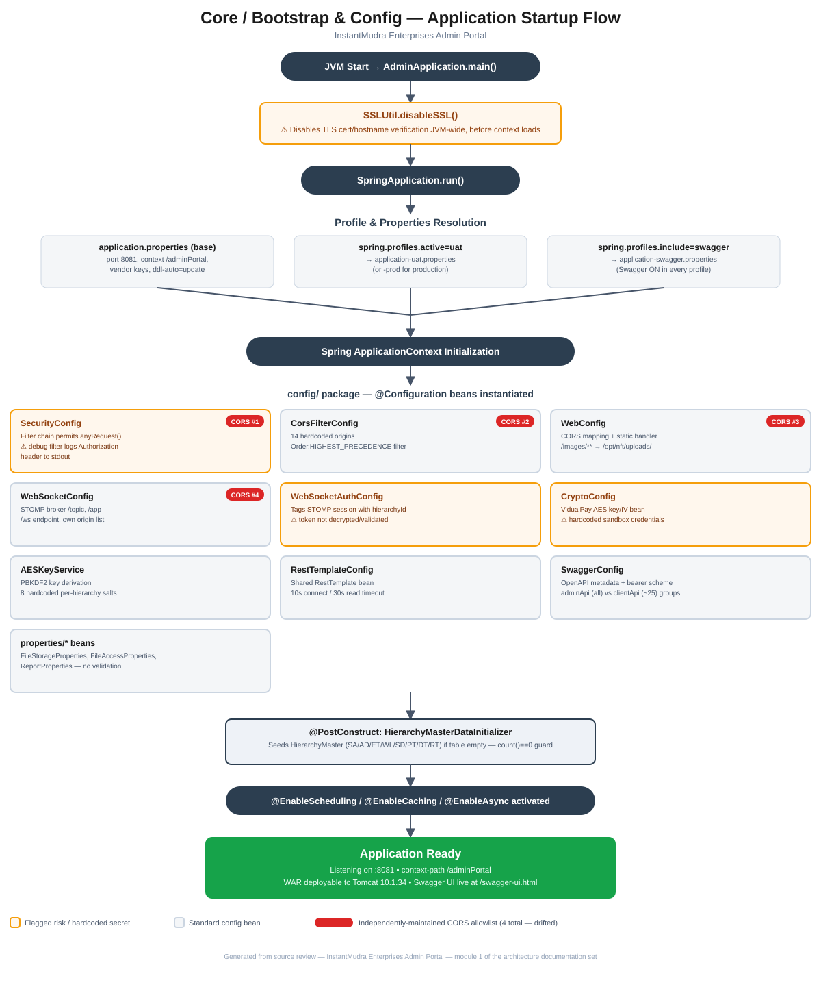

# Module 1: Core / Bootstrap & Config

> Part of the InstantMudra Enterprises Admin Portal architecture documentation.
> Covers application bootstrap, build definition, environment configuration, and the global `config/` package.

## Figure 1 — Startup flow diagram



*(Standalone version: [`01-core-bootstrap-config-flow.pdf`](01-core-bootstrap-config-flow.pdf) / [`.svg`](01-core-bootstrap-config-flow.svg))*

---

> Secrets below are masked (`••••••`) — see the actual `.properties` files in `src/main/resources/` for real values. Do not copy real values into this document.

## 1. Application entry point

**File:** [`AdminApplication.java`](../../src/main/java/com/im/admin/AdminApplication.java)

```java
@SpringBootApplication(scanBasePackages = "com.im.admin")
@EntityScan(basePackages = "com.im.admin.entities")
@EnableCaching
@EnableScheduling
@EnableAsync
public class AdminApplication extends SpringBootServletInitializer
```

- Single-package-root Spring Boot app (`com.im.admin`), deployed as a **WAR** — `SpringBootServletInitializer` is extended so the same artifact can run embedded (`spring-boot:run`) or be dropped into an external Tomcat.
- `@EnableCaching`, `@EnableScheduling`, `@EnableAsync` are turned on application-wide — this is what allows `cronJob/` schedulers and any `@Async` service methods to function.
- Declares one bean directly in the application class: `ModelMapper` (used throughout `mapper/`/`service` layers for entity↔DTO conversion).
- `main()` calls `SSLUtil.disableSSL()` **before** `SpringApplication.run(...)`.

### ⚠️ Notable: global TLS verification is disabled at startup

[`SSLUtil.java`](../../src/main/java/com/im/admin/util/SSLUtil.java) installs a JVM-wide `X509TrustManager` that accepts **any** certificate and a `HostnameVerifier` that accepts **any** hostname, then sets both as the **default** for `HttpsURLConnection`:

```java
HttpsURLConnection.setDefaultSSLSocketFactory(sc.getSocketFactory());
HttpsURLConnection.setDefaultHostnameVerifier((hostname, session) -> true);
```

This runs once at process startup and affects every outbound HTTPS call made via `HttpsURLConnection` for the lifetime of the JVM (not scoped to one client/vendor). In practice this weakens TLS validation for all the vendor integrations (AEPS/DMT/BBPS/PG/payout callable APIs) that don't use a hardened HTTP client, making them vulnerable to MITM if traffic is ever interceptable. This looks like it was added to work around a specific vendor's certificate problem but is applied globally and unconditionally — worth flagging as a security risk to fix deliberately (e.g. scope it to a dedicated `RestTemplate`/`OkHttpClient` for the one vendor that needs it) rather than something to silently work around.

---

## 2. Build definition (`pom.xml`)

- **Parent:** `spring-boot-starter-parent` **3.4.2**
- **Java:** 17
- **Packaging:** `war`, final artifact name fixed to `enterprises` → `target/enterprises.war`
- **groupId/artifactId:** `com.im.admin` / `enterprises`

### Key dependencies (by purpose)

| Purpose | Dependency |
|---|---|
| Web/JPA/AOP/Security/Validation/Mail/WebSocket/Actuator | `spring-boot-starter-{web, data-jpa, aop, security, validation, mail, websocket, actuator}` |
| Reactive HTTP client | `spring-boot-starter-webflux` (used alongside servlet-stack `web`, not instead of it) |
| DB driver | `mysql-connector-j` (runtime) |
| Boilerplate reduction | `lombok` 1.18.30 (provided) |
| JWT (present but **dead** — see Auth module) | `jjwt-api`/`jjwt-impl`/`jjwt-jackson` 0.11.5 |
| API docs | `springdoc-openapi-starter-webmvc-ui` 2.8.5 |
| Object mapping | `modelmapper` 3.2.0 |
| Jackson extras | `jackson-datatype-jsr310`, `jackson-datatype-hibernate5-jakarta` 2.18.2 |
| Payment gateway SDKs | `razorpay-java` 1.4.3, `com.cashfree.pg.java:cashfree_pg` 5.0.1 |
| Reporting/export | `poi-ooxml` 5.2.3, `opencsv` 5.7.1, `commons-csv` 1.10.0 |
| HTTP client | `okhttp` 4.10.0 |
| Crypto | `bcprov-jdk15on` 1.70 (BouncyCastle) |
| Templating | `spring-boot-starter-thymeleaf` |

No test dependencies beyond the default `spring-boot-starter-test` — consistent with the top-level finding that there's effectively no test suite.

### Build plugins

- `maven-compiler-plugin` wired to run the Lombok annotation processor.
- `spring-boot-maven-plugin` explicitly **excludes** Lombok from the repackaged artifact (correct — it's a compile-time-only tool).

---

## 3. Configuration profiles

Base file: [`application.properties`](../../src/main/resources/application.properties). Profile-specific overrides layer on top via:

```properties
spring.profiles.active=uat
spring.profiles.include=swagger
```

So by default the app runs as **UAT + Swagger enabled** unless `spring.profiles.active` is overridden (e.g. at deploy time for prod).

### 3.1 `application.properties` (base — applies to every profile)

| Setting | Value | Note |
|---|---|---|
| `spring.application.name` | `Admin` | |
| `server.port` | `8081` | |
| `server.servlet.context-path` | `/adminPortal` | All routes are mounted under this prefix |
| `spring.jpa.hibernate.ddl-auto` | `update` | Schema is auto-migrated on boot — no Flyway/Liquibase. Risky for prod. |
| `spring.jpa.show-sql` | `true` | SQL logging on even in the base profile |
| `logging.level.root` | `ERROR` | but `com.im` → `INFO` |
| `file.upload.base-dir` | `/opt/nft/uploads` | bound to `FileStorageProperties` |
| `app.security.base-secret` | `••••••` | PBKDF2 base secret for the AES token scheme — see Auth module |
| `app.security.pbkdf2-iterations` / `-keylength` | `65536` / `128` | |
| `jwt.secret` / `jwt.expiration` | `••••••` / `3600000` | **Dead** — `JwtUtil` is unreferenced (confirmed in Auth module review) |
| `spring.datasource.hikari.maximum-pool-size` / `minimum-idle` | `20` / `5` | |
| `reports.retention-days` | `90` | bound to `ReportProperties` |
| `spring.task.scheduling.pool.size` | `5` | shared thread pool for all `cronJob/` schedulers |
| Vendor credentials | RunPaisa, Paysprint, Shiv SMS, Surepass DigiLocker, InstantMudra gateway | All live in plaintext here — `••••••` in this doc |
| `payout.client_id` / `payout.client_secret` | `not yet` / `not yet` | **Literal placeholder text**, not real credentials — payout vendor config is incomplete (already flagged at top-level) |

**This file is where most vendor API keys live in plaintext**, committed to source control (confirmed by `.gitignore` review — properties files are not excluded). This is a standing risk independent of any one module; treat any credential-rotation or secrets-migration work as touching this file.

### 3.2 `application-uat.properties`

- DB: `192.168.0.67:3306/IM_Admin_Portal` (internal-network host, credentials in plaintext)
- RunPaisa **test/dev** endpoints (`dev.api.runpaisa.com`, `test.api.pg.runpaisa.com`)
- `file.access.base-url = https://uat.nfttech.in/enterprises/images/`
- `reports.base-dir = /opt/decipay/Hourly_Reports`

### 3.3 `application-prod.properties`

- DB: `10.1.1.4:3306/nfttech_enterprises` — **note the different DB name** (`nfttech_enterprises` vs. UAT's `IM_Admin_Portal`) and `useSSL=false` on the JDBC URL (DB traffic unencrypted)
- RunPaisa **live** endpoints (`api.runpaisa.com`, `api.pg.runpaisa.com`)
- `file.access.base-url = https://api.nfttech.in/enterprises/images/`
- `file.access.config-assets-path = /wl-assets` (differs from UAT's `/enterprises/images`)
- `reports.base-dir = /opt/nft/reports/Hourly_Reports`

### 3.4 `application-swagger.properties`

Included by default (`spring.profiles.include=swagger`), so **Swagger/OpenAPI UI is on in every environment unless explicitly excluded** — including prod, per the `springdoc.servers[0].url` pointing at `https://api.nfttech.in/enterprises`. Exposes `/swagger-ui.html` and `/v3/api-docs`, both whitelisted as unauthenticated in `SecurityConfig`/`AESFilter`.

---

## 4. `config/` package — Spring `@Configuration` classes

| Class | Responsibility | Notes / issues |
|---|---|---|
| [`SecurityConfig`](../../src/main/java/com/im/admin/config/SecurityConfig.java) | Spring Security filter chain, `PasswordEncoder`, global `ObjectMapper`, one of the CORS sources | `securityFilterChain()` permits `anyRequest()` — real auth enforcement happens in `AESFilter`, not here (see Auth module). Also registers a **debug filter that logs every request's `Authorization` header to stdout** (`System.out.println("AUTH HDR : " + ...)`) — this leaks bearer tokens into application logs and should not run in production. |
| [`CorsFilterConfig`](../../src/main/java/com/im/admin/config/CorsFilterConfig.java) | A `CorsFilter` bean at `Ordered.HIGHEST_PRECEDENCE`, explicit origin allowlist | **Independent, hand-maintained origin list** — 14 entries (localhost, uat.decipay.in, internal IPs, and per-whitelabel portal domains). |
| [`WebConfig`](../../src/main/java/com/im/admin/config/WebConfig.java) | `WebMvcConfigurer` CORS mapping + static resource handler for `/images/**` → `/opt/nft/uploads/` | **A second, separately-maintained CORS origin list**, near-identical to `CorsFilterConfig`'s but not guaranteed to stay in sync. |
| [`WebSocketConfig`](../../src/main/java/com/im/admin/config/WebSocketConfig.java) | STOMP broker (`/topic`, `/app` prefixes), `/ws` endpoint registration | **A third CORS/allowed-origins list**, again hand-copied and already missing entries the other lists have — confirms the top-level finding of drifted CORS allowlists extends to 3-4 places, not the 3 originally counted (`SecurityConfig` also sets `allowedOriginPatterns` to just 2 wildcard patterns, a 4th, looser list). |
| [`WebSocketAuthConfig`](../../src/main/java/com/im/admin/config/WebSocketAuthConfig.java) | Inbound STOMP channel interceptor | On `CONNECT`, splits the raw `Authorization` token on `\|` and tags the session with `hierarchyId` — **does not decrypt or validate the token** (matches top-level finding). A missing header is silently allowed through (no `else` branch rejecting the connection). |
| [`CryptoConfig`](../../src/main/java/com/im/admin/config/CryptoConfig.java) | Registers `VidualPayCryptoUtil` bean with hardcoded AES key/IV | Comment explicitly warns "sandbox credentials" and "DO NOT swap these" — vendor-specific, hardcoded secret in source rather than `.properties`. |
| [`AESKeyService`](../../src/main/java/com/im/admin/config/AESKeyService.java) | Derives PBKDF2 keys from `app.security.base-secret` + a per-hierarchy-level salt (8 hardcoded salts, one per `HierarchyMaster` code SA/AD/ET/WL/SD/PT/DT/RT) | Core primitive behind `AESFilter`'s token scheme — full flow documented in the Auth module. All 8 salts are hardcoded constants here, not configuration. |
| [`RestTemplateConfig`](../../src/main/java/com/im/admin/config/RestTemplateConfig.java) | One shared `RestTemplate` bean, 10s connect / 30s read timeout | Generic — used by vendor integrations that haven't rolled their own HTTP client (many use `okhttp`/`WebClient` directly instead; no single enforced HTTP client convention). |
| [`HierarchyMasterDataInitializer`](../../src/main/java/com/im/admin/config/HierarchyMasterDataInitializer.java) | `@PostConstruct` seeder — inserts the 8 `HierarchyMaster` rows (SuperAdmin…Retailer) if the table is empty | Idempotent guard via `count() == 0`; this is the source of truth for the hierarchy level codes referenced everywhere else in the app. |
| [`SwaggerConfig`](../../src/main/java/com/im/admin/config/SwaggerConfig.java) | OpenAPI metadata, bearer auth scheme, two API groups | `adminApi` group exposes **every** endpoint (`pathsToMatch("/**")`); `clientApi` group is an allowlist of ~25 controller names meant to scope down what's shown to external/client-facing consumers of the Swagger doc. Since Swagger is live in prod (see §3.4), this grouping is the only thing limiting what a public visitor to `/swagger-ui.html` sees by default — worth confirming `admin-api` group isn't also publicly selectable if that distinction matters. |

---

## 5. `properties/` package — typed `@ConfigurationProperties`

| Class | Prefix | Field(s) | Bound by |
|---|---|---|---|
| [`FileStorageProperties`](../../src/main/java/com/im/admin/properties/FileStorageProperties.java) | `file.upload` | `baseDir` | `file.upload.base-dir` (base properties) |
| [`FileAccessProperties`](../../src/main/java/com/im/admin/properties/FileAccessProperties.java) | `file.access` | `baseUrl` | `file.access.base-url` (per-profile, UAT vs. prod) |
| [`ReportProperties`](../../src/main/java/com/im/admin/properties/ReportProperties.java) | `reports` | `baseDir` | `reports.base-dir` (per-profile) |
| [`FileUrlUtil`](../../src/main/java/com/im/admin/properties/FileUrlUtil.java) | — | helper, not properties itself | Concatenates `FileAccessProperties.baseUrl` + a relative path to build a public image URL; used wherever uploaded file URLs are returned to clients |

All three properties classes are minimal single-field wrappers — no validation (`@NotBlank` etc.) on any of them, so a missing/misspelled property silently yields `null` rather than failing fast at startup.

---

## 6. Summary of risks specific to this module

1. **JVM-wide TLS verification disabled at startup** (`SSLUtil.disableSSL()`, called unconditionally from `main()`) — the most serious finding in this module.
2. **Authorization header logged to stdout** by the debug filter in `SecurityConfig` — token leakage into logs.
3. **Four independently-maintained CORS/origin allowlists** (`SecurityConfig`, `CorsFilterConfig`, `WebConfig`, `WebSocketConfig`) that already differ from each other — adding a new frontend domain requires remembering to touch all four.
4. **Credentials committed in plaintext** across `application.properties` / `application-uat.properties` / `application-prod.properties` (DB passwords, vendor API secrets, DigiLocker JWT, hardcoded AES key/IV in `CryptoConfig`).
5. **`spring.jpa.hibernate.ddl-auto=update`** in the base profile — schema auto-migration with no versioned migration tool, applies to prod too unless overridden.
6. **Swagger/OpenAPI enabled by default in every profile including prod** (`spring.profiles.include=swagger`), gated only by the `clientApi` vs. `adminApi` grouping, not by environment.
7. **No `@Validated`/required checks** on the typed properties classes — misconfiguration fails silently (`null`) rather than at boot.

These overlap with, and add detail to, the "Config" and "CORS" bullets in the top-level [`CLAUDE.md`](../../CLAUDE.md) known-issues list — this document is the fuller writeup for that module.

---

*Next module (pending your go-ahead): Hierarchy & Access Model.*
