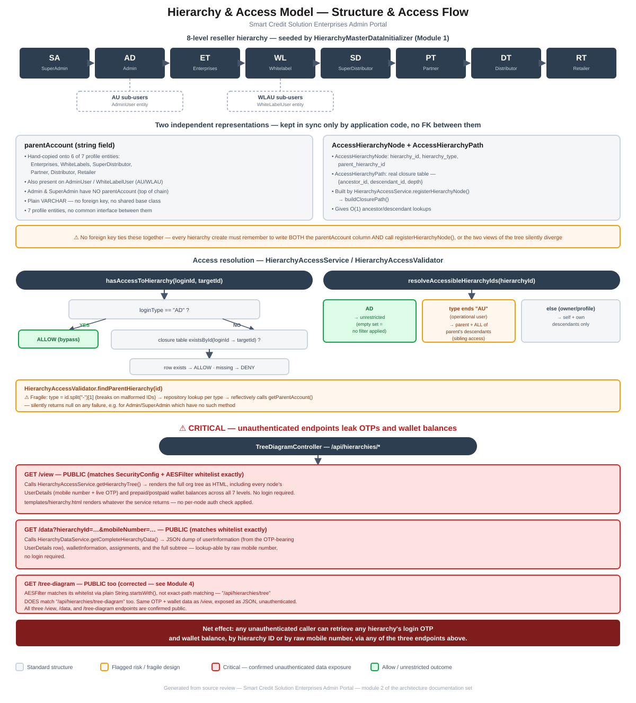

# Module 2: Hierarchy & Access Model

> Part of the Smart Credit Solution Enterprises Admin Portal architecture documentation.
> Covers the reseller hierarchy structure, its two parallel representations, the access-resolution logic, and the profile entities that sit at each level.

## Figure 1 — Structure & access flow diagram

*(Standalone version: [`02-hierarchy-access-model-flow.pdf`](02-hierarchy-access-model-flow.pdf) / [`.svg`](02-hierarchy-access-model-flow.svg))*

---

## 1. The hierarchy chain and its seed data

[`HierarchyMaster`](../../src/main/java/com/scs/admin/entities/HierarchyMaster.java) is a flat lookup table (`sr_no`, `name`, `code`) with 8 rows, seeded once at boot by [`HierarchyMasterDataInitializer`](../../src/main/java/com/scs/admin/config/HierarchyMasterDataInitializer.java) (see [Module 1](01-core-bootstrap-config.md#4-config-package--spring-configuration-classes)) if the table is empty:

| Code | Name |
|---|---|
| `SA` | SuperAdmin |
| `AD` | Admin |
| `ET` | Enterprises |
| `WL` | Whitelabel |
| `SD` | SuperDistributor |
| `PT` | Partner |
| `DT` | Distributor |
| `RT` | Retailer |

These codes are embedded directly into every hierarchy ID string in the system (e.g. `SCS-RT-001`, `ABC-ET-001`) and are parsed back out by string-splitting in multiple places (`HierarchyType.fromId()`, `HierarchyAccessValidator.extractHierarchyType()`, `TokenUtil.extractHierarchyId()`) rather than through a single shared parser — see §4.

Two hierarchy levels additionally have **operational sub-user** accounts, stored in their own entities rather than as rows in the main chain:

- **`AU`** — `AdminUser` entity, sub-accounts under an `AD` (Admin)
- **`WLAU`** — `WhiteLabelUser` entity, sub-accounts under a `WL` (Whitelabel)

Both carry their own `parentAccount` pointing at the owning `AD`/`WL`, and both are treated specially by the access-resolution logic (§4) — a type ending in `"AU"` gets broader, sibling-level visibility rather than being scoped to its own subtree.

`HierarchyType` (an enum covering `ET`/`WL`/`SD`/`PT`/`DT`/`RT` — notably **not** `SA`/`AD`) also has a `fromId(String)` helper that infers type by checking whether the ID string contains `"-XX-"` for each code — a second, independent way of extracting hierarchy type from an ID string, alongside `HierarchyAccessValidator.extractHierarchyType()`'s `id.split("-")[1]` and `CommonMethods.extractHierarchyType()` (used by `HierarchyAccessService`). Three different call sites reimplement essentially the same string-parsing logic.

---

## 2. Two independent representations of the same tree

The top-level project documentation already flags that two representations of the hierarchy tree coexist. This module owns both of them:

### 2.1 `parentAccount` — a hand-copied string field

Six of the seven profile entities carry a plain `parentAccount` column pointing at their immediate parent's ID:

| Entity | ID field | `parentAccount`? |
|---|---|---|
| [`SuperAdmin`](../../src/main/java/com/scs/admin/entities/SuperAdmin.java) | `id` | **No** — root of the chain |
| [`Admin`](../../src/main/java/com/scs/admin/entities/Admin.java) | `id` | **No** — sits directly under SuperAdmin, not tracked via `parentAccount` |
| [`Enterprises`](../../src/main/java/com/scs/admin/entities/Enterprises.java) | `enterpriseId` | Yes |
| [`WhiteLabels`](../../src/main/java/com/scs/admin/entities/WhiteLabels.java) | `whiteLabelId` | Yes |
| [`SuperDistributor`](../../src/main/java/com/scs/admin/entities/SuperDistributor.java) | `superDistributorId` | Yes |
| [`Partner`](../../src/main/java/com/scs/admin/entities/Partner.java) | `partnerId` | Yes |
| [`Distributor`](../../src/main/java/com/scs/admin/entities/Distributor.java) | `distributorId` | Yes |
| [`Retailer`](../../src/main/java/com/scs/admin/entities/Retailer.java) | `retailerId` | Yes |
| `AdminUser` (`AU`) | `id` | Yes — points at the owning `AD` |
| `WhiteLabelUser` (`WLAU`) | `id` | Yes — points at the owning `WL` |

This contradicts the top-level `CLAUDE.md` summary, which describes `parentAccount` as present on "each of the seven profile entities" — **`Admin` verifiably has no such field**; only `SuperAdmin` and `Admin` are excluded, and the two operational-user entities (`AdminUser`/`WhiteLabelUser`) also carry it even though they aren't one of the seven.

There is **no shared base interface or superclass** across these entities for `parentAccount` (or for anything else describing "a hierarchy node") — `HierarchyAccessValidator.extractParentAccount()` has to call `getParentAccount()` via **Java reflection** on whatever entity type it looked up, because there's no common type to call it through directly (see §4.2). `parentAccount` is a plain `VARCHAR` column with no foreign key, so nothing in the database enforces that it points at a real, existing parent row.

### 2.2 `AccessHierarchyNode` + `AccessHierarchyPath` — a real closure table

Alongside the string field, [`AccessHierarchyNode`](../../src/main/java/com/scs/admin/entities/AccessHierarchyNode.java) and [`AccessHierarchyPath`](../../src/main/java/com/scs/admin/entities/AccessHierarchyPath.java) implement a proper [closure table](https://en.wikipedia.org/wiki/Nested_set_model) pattern:

- **`AccessHierarchyNode`**: one row per hierarchy ID — `hierarchy_id` (PK), `hierarchy_type`, `parent_hierarchy_id`, `created_on`.
- **`AccessHierarchyPath`**: one row per **(ancestor, descendant)** pair, keyed by the embeddable [`AccessHierarchyPathId`](../../src/main/java/com/scs/admin/entities/AccessHierarchyPathId.java) (`ancestor_id`, `descendant_id`), plus `depth`. A node's self-relation (depth 0) is stored too.

This is built by [`HierarchyAccessService`](../../src/main/java/com/scs/admin/service/HierarchyAccessService.java):

- `registerHierarchyNode(request)` inserts the `AccessHierarchyNode` row, then calls `buildClosurePath(hierarchyId, parentHierarchyId)`.
- `buildClosurePath()` inserts the self-path (depth 0), then — for every existing path ending at the parent — inserts a new path from that same ancestor to the new node at `parentDepth + 1`. This is the standard closure-table insert algorithm and is correct as written.

[`AccessHierarchyPathRepository`](../../src/main/java/com/scs/admin/repositories/AccessHierarchyPathRepository.java) backs this with well-formed JPQL/native queries — `findDescendantsByAncestor`, `findAllDescendants` (joined with `AccessHierarchyNode` for a full projection), `countHierarchyUnderWhiteLabel` (native SQL), `deleteByDescendantExcludingSelf`, etc. Of everything reviewed in this module, **the closure-table plumbing itself is solid** — the risk is not in this code, it's in the fact that a second, unrelated representation (`parentAccount`) exists alongside it.

### 2.3 The sync problem

**Nothing ties the two representations together at the database level.** Creating a new hierarchy entity means the calling code must remember to:

1. Insert the profile row with the correct `parentAccount`, **and**
2. Call `HierarchyAccessService.registerHierarchyNode()` to insert the matching `AccessHierarchyNode` + closure-table rows.

If either step is skipped — a missed call, a failed transaction that rolls back one write but not both (no evidence either write is wrapped in the same `@Transactional` boundary as entity creation), or a future code path that only updates one side — the two views of the tree silently diverge: `parentAccount` might say one thing while the closure table says another (or is simply missing that node). Nothing in the schema would catch this.

---

## 3. Profile entities — shape and inconsistencies

The seven profile entities (`Admin`, `Enterprises`, `WhiteLabels`, `SuperDistributor`, `Partner`, `Distributor`, `Retailer`) plus `SuperAdmin` all model roughly the same "reseller registration" shape — KYC fields (Aadhaar/PAN images and numbers), embedded `Address` (main + outlet), bank details, a `status` workflow (`PENDING`/approved/rejected with `rejectionReason`/`rejectedBy`/`rejectedOn`/`approvedBy`/`approvedOn`), and audit fields (`createdOn`/`createdBy`/`editedOn`/`editedBy`) — but **duplicate that shape independently rather than sharing it**:

- [`BaseEntity`](../../src/main/java/com/scs/admin/entities/BaseEntity.java) is a `@MappedSuperclass` providing `createdOn`/`createdBy`/`editedOn`/`editedBy`/`approvedOn`/`approvedBy`, watched by `AuditEntityListener` (which, per the top-level findings, always stamps `"SYSTEM"` since Spring Security's context is never populated under this app's AES-based auth).
- **Only `Admin` and `SuperAdmin` extend `BaseEntity`.** `Enterprises`, `Retailer`, `WhiteLabels`, `SuperDistributor`, `Partner`, and `Distributor` do **not** — each one hand-declares the same six audit columns inline instead. `Enterprises` even has its `@UpdateTimestamp` annotation commented out on `editedOn` (`//    @UpdateTimestamp`), so that field won't auto-update on edit the way `BaseEntity`'s does.
- Every entity also hand-declares its own KYC/address/status fields rather than sharing a mixin — `Retailer` and `Enterprises` both have nearly identical `@PrePersist prePersistDefaults()` methods that null-fill the embedded `Address`/outlet `Address` with `"N/A"`, copy-pasted rather than shared.

Net effect: there are effectively **two different entity lineages** (audited-via-`BaseEntity` vs. hand-rolled) doing the same job, and any future change to the shared shape (e.g. adding a new KYC field or fixing the audit-stamping bug) has to be applied in up to eight places.

`UserDetails` (composite key: `mobileNumber` + `hierarchyId`) is the actual **login/credential record** — separate again from the profile entities above. It holds `loginUserName`/`loginPassword`, `otp`/`otpExpiryTime`, `failedAttempts`/`isBlocked`/`lockTime`, and its own `parentAccount`. This is the table at the center of the exposure described in §5.

---

## 4. Access resolution

### 4.1 `HierarchyAccessService`

Two methods do the actual access-scoping work:

**`hasAccessToHierarchy(loginHierarchyId, targetHierarchyId)`** — a simple boolean check:
- Returns `true` unconditionally if the caller's type (via `CommonMethods.extractHierarchyType()`) is `"AD"` — a full bypass, matching the top-level finding.
- Otherwise, checks whether the closure table has a row for `(loginHierarchyId → targetHierarchyId)` via `pathRepository.existsById(...)`. If that path doesn't exist, access is denied.

**`resolveAccessibleHierarchyIds(hierarchyId)`** — returns the *set* of hierarchy IDs the caller may see:
- `"AD"` → returns an **empty set**, which callers are expected to treat as "no filter" (unrestricted) — a convention that only works if every caller remembers empty-means-everything rather than empty-means-nothing.
- A type ending in `"AU"` (i.e. `AU` or `WLAU`, an operational sub-user) → adds the sub-user's **parent** hierarchy ID, plus **every descendant of that parent** — meaning an operational user under a Whitelabel sees everything under that Whitelabel, not just their own account. This is a deliberate design choice (operational staff acting on behalf of their principal) but is worth knowing explicitly since it's broader than a naive reading of "sub-user" might suggest.
- Anything else (a normal profile entity acting as itself) → self plus its own descendants only, via `pathRepo.findDescendantsByAncestor(hierarchyId)`.

The class also contains a large, **mostly-commented-out** earlier version of `getHierarchyTree()` (~150 lines, `//`-prefixed) sitting directly above the live implementation — dead code left in place rather than removed, making the file harder to read than it needs to be.

### 4.2 `HierarchyAccessValidator`

A separate, smaller component with a **different** access-related job: given a hierarchy ID, find its parent.

`findParentHierarchy(hierarchyId)`:
1. Extracts type via `id.split("-")[1]` — will throw `ArrayIndexOutOfBoundsException` on any ID that doesn't contain at least two `-`-separated segments (no validation beforehand).
2. `switch`es on that type to pick the right JPA repository (`ET`→`enterprisesRepository`, `WL`→`whiteLabelRepository`, `WLAU`→`whiteLabelUserRepository`, `SD`/`PT`/`DT`/`RT`/`AU` similarly; anything else → `Optional.empty()`).
3. Calls `extractParentAccount(entity)`, which uses **reflection** (`entity.getClass().getMethod("getParentAccount").invoke(entity)`) to read the field generically — necessary only because, per §2.1, there's no shared interface exposing `getParentAccount()` across entity types. Any reflection failure (including calling it on an entity type that genuinely has no such method, like `Admin`) is caught by a blanket `catch (Exception e)` and silently returns `null`, with no logging.

A second method, `belongsToHierarchy(...)`, is present but **entirely commented out** — dead code, similar to the pattern seen in `HierarchyAccessService`.

Note that `HierarchyAccessService.hasAccessToHierarchy()` and `HierarchyAccessValidator` are **two separate, independently-written pieces of access logic** with overlapping purposes (one checks "can A see B", the other resolves "who is B's parent") — there's no single authoritative access-check entry point that all controllers are guaranteed to call, which is consistent with the top-level finding that access enforcement is inconsistently applied across controllers.

---

## 5. Critical finding: unauthenticated hierarchy/OTP/wallet exposure

[`TreeDiagramController`](../../src/main/java/com/scs/admin/controller/TreeDiagramController.java) (`@RequestMapping("/api/hierarchies")`) exposes the entire tree, and **all three** of its read endpoints are reachable **without authentication**:

| Endpoint | Public? | What it returns |
|---|---|---|
| `GET /api/hierarchies/view` | **Yes** — matches both `SecurityConfig.PATHS_VIEWABLE_WITHOUT_AUTHENTICATION` and `AESFilter`'s whitelist | Calls `HierarchyAccessService.getHierarchyTree()`, renders `templates/hierarchy.html` with the **full org tree** — every node's `UserDetails` (mobile number + **live OTP**, via the service's internal `loadAllUserDetails()`) and prepaid/postpaid wallet balances across all 7 levels (via `loadAllWalletBalances()`). No hierarchy scoping, no auth check inside the controller or service. |
| `GET /api/hierarchies/data?hierarchyId=&mobileNumber=` | **Yes** — matches both whitelists | Calls `HierarchyDataService.getCompleteHierarchyData()`, which accepts **either** a hierarchy ID **or a raw mobile number** as a lookup key and returns `userInformation` (built from the OTP-bearing `UserDetails` row), `walletInformation`, `assignments`, and the full `underHierarchy` subtree — as JSON, to anyone. |
| `GET /api/hierarchies/tree-diagram` | **Yes** — see correction below | The actual JSON tree endpoint (`hierarchyAccessService.getHierarchyTree()` as JSON) — same OTP + wallet data as `/view`, just as JSON. |

> **Correction (added after [Module 4](04-authentication-security.md#21-whitelist-matching-is-stringstartswith-not-exact-path)):** this section originally assessed `/api/hierarchies/tree-diagram` as "effectively no[t public]", reasoning that both whitelists only contain the literal string `/api/hierarchies/tree` (no wildcard) and that a plain string without wildcards is an exact match — true for `SecurityConfig`'s Spring Security `.requestMatchers()`, but **`SecurityConfig`'s chain permits `anyRequest()` regardless, so it was never the operative check to begin with.** `AESFilter` — the filter that actually gates every request — matches its whitelist using plain `String.startsWith()`, not exact-path matching. `"/api/hierarchies/tree-diagram".startsWith("/api/hierarchies/tree")` is `true`, so this endpoint **is** covered by that whitelist entry and **is** publicly reachable. All three endpoints in the table above are confirmed public.

**Net effect: any unauthenticated request can pull any hierarchy's login OTP and current wallet balance, either by hierarchy ID or by raw mobile number**, via `/api/hierarchies/view` (HTML), `/api/hierarchies/data` (JSON), or `/api/hierarchies/tree-diagram` (JSON). This is a materially more severe version of the top-level finding about `DashboardController` not checking `HierarchyAccessService` — that case at least requires a valid authenticated token; this one requires nothing at all. This should be treated as a top-priority fix arising from this module's review — though [Module 4](04-authentication-security.md) subsequently found an even more severe, systemic authentication-bypass issue in `AESFilter` itself, which supersedes this as the single highest-priority item overall.

---

## 6. Summary of risks specific to this module

1. **`/api/hierarchies/view` and `/api/hierarchies/data` are unauthenticated and leak OTPs, passwords-adjacent credentials context, and wallet balances for the entire organization** — the most severe finding in this module (§5).
2. **Two unsynchronized representations of the same tree** (`parentAccount` string vs. `AccessHierarchyNode`/`AccessHierarchyPath` closure table) with no foreign key or transactional guarantee tying them together (§2.3).
3. **No shared base type across the 7 profile entities** — `parentAccount` access requires reflection in `HierarchyAccessValidator`, and audit-field handling is duplicated (and in `Enterprises`' case, subtly broken — a disabled `@UpdateTimestamp`) instead of inherited from `BaseEntity` (§3).
4. **Fragile, duplicated hierarchy-type parsing** — at least three independent implementations of "extract the type code from an ID string" (`HierarchyType.fromId()`, `HierarchyAccessValidator.extractHierarchyType()`, `CommonMethods.extractHierarchyType()`), one of which (`id.split("-")[1]`) throws on malformed input rather than validating (§1, §4.2).
5. **`HierarchyAccessValidator.extractParentAccount()` silently swallows all reflection failures** and returns `null` with no logging — a real error (e.g. a genuinely broken entity) is indistinguishable from "this entity type has no parent" (§4.2).
6. **Two independent, overlapping access-logic components** (`HierarchyAccessService` and `HierarchyAccessValidator`) with no single enforced entry point — consistent with, and a partial root cause of, the top-level finding that access checks aren't applied consistently across controllers (§4).
7. **Dead, commented-out code left in place** in both `HierarchyAccessService` (a ~150-line earlier `getHierarchyTree()`) and `HierarchyAccessValidator` (`belongsToHierarchy()`), adding noise without adding value.

These add hierarchy-specific detail to the "Authorization" bullet in the top-level [`CLAUDE.md`](../../CLAUDE.md) known-issues list, and identify a new, more severe unauthenticated-access issue not previously catalogued there.

---

*Next module (pending your go-ahead): Wallets & Ledger.*
