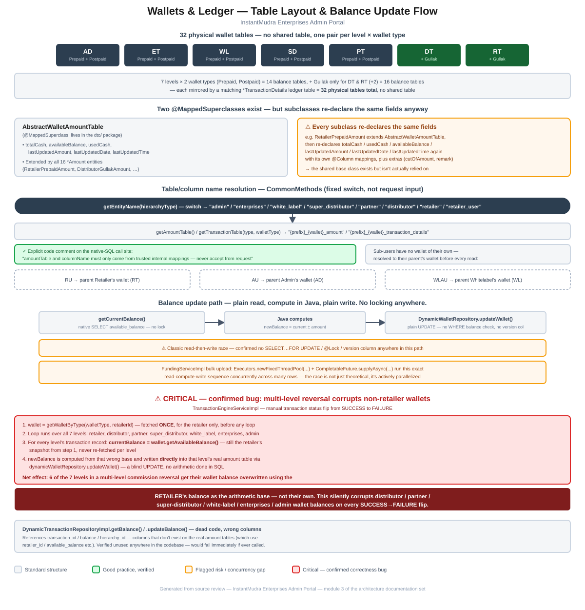

# Module 3: Wallets & Ledger

> Part of the InstantMudra Enterprises Admin Portal architecture documentation.
> Covers the per-level wallet/ledger table pairs, the raw-JDBC table-resolution layer, the balance update path, and a confirmed correctness bug in transaction reversal.

## Figure 1 — Table layout & balance update flow diagram



*(Standalone version: [`03-wallets-ledger-flow.pdf`](03-wallets-ledger-flow.pdf) / [`.svg`](03-wallets-ledger-flow.svg))*

---

## 1. 32 physical wallet tables — no shared table

Every hierarchy level except `SuperAdmin` has its own **Prepaid** and **Postpaid** wallet-balance table plus a matching ledger (`*TransactionDetails`) table, and `Retailer`/`Distributor` additionally have a third wallet type, **Gullak** (a savings-style sub-wallet):

| Level | Balance tables | Ledger tables |
|---|---|---|
| Admin (`AD`) | `admin_prepaid_amount`, `admin_postpaid_amount` | `admin_prepaid_transaction_details`, `admin_postpaid_transaction_details` |
| Enterprises (`ET`) | `enterprises_prepaid_amount`, `enterprises_postpaid_amount` | matching `*_transaction_details` |
| Whitelabel (`WL`) | `white_label_prepaid_amount`, `white_label_postpaid_amount` | matching `*_transaction_details` |
| SuperDistributor (`SD`) | `super_distributor_prepaid_amount`, `super_distributor_postpaid_amount` | matching `*_transaction_details` |
| Partner (`PT`) | `partner_prepaid_amount`, `partner_postpaid_amount` | matching `*_transaction_details` |
| Distributor (`DT`) | prepaid, postpaid, **+ Gullak** | matching `*_transaction_details` (3) |
| Retailer (`RT`) | prepaid, postpaid, **+ Gullak** | matching `*_transaction_details` (3) |

**Total: 7 levels × 2 wallet types = 14 balance tables, + Gullak on `DT`/`RT` only (+2) = 16 balance tables, each mirrored by a matching ledger table = 32 physical tables**, confirmed by directly listing every `*Amount`/`*TransactionDetails`/`*Gullak*` entity file. There is no shared physical table, no polymorphic single-table/joined-table JPA inheritance strategy, and no view unifying them — each is a fully independent table pair.

---

## 2. Two `@MappedSuperclass`es exist, but aren't fully relied on

### 2.1 `AbstractWalletAmountTable`

[`AbstractWalletAmountTable`](../../src/main/java/com/im/admin/dto/AbstractWalletAmountTable.java) is a `@MappedSuperclass` (oddly placed in the `dto/` package rather than `entities/`) declaring the common balance fields: `totalCash`, `availableBalance`, `usedCash`, `lastUpdatedAmount`, `lastUpdatedDate`, `lastUpdatedTime`. All 16 `*Amount` entities (e.g. [`RetailerPrepaidAmount`](../../src/main/java/com/im/admin/entities/RetailerPrepaidAmount.java), [`RetailerGullakAmount`](../../src/main/java/com/im/admin/entities/RetailerGullakAmount.java)) extend it.

**However, every subclass re-declares the exact same fields again**, each with its own `@Column` annotation, plus a couple of extras (`cutOfAmount`, `remark`) that aren't on the parent at all:

```java
public class RetailerPrepaidAmount extends AbstractWalletAmountTable {
    @Column(name = "total_cash")        private BigDecimal totalCash = BigDecimal.ZERO;
    @Column(name = "used_cash")         private BigDecimal usedCash = BigDecimal.ZERO;
    @Column(name = "cut_of_amount")     private BigDecimal cutOfAmount = BigDecimal.ZERO;
    @Column(name = "available_balance") private BigDecimal availableBalance = BigDecimal.ZERO;
    // ...same names as the parent's unmapped fields
}
```

The parent class's fields carry no `@Column` mapping of their own, so in practice the subclass's redeclared, annotated fields are what get persisted — but this means the shared base class contributes **no actual field-sharing benefit**; every subclass still has to write out the full field list by hand. This is the same "shared base class exists but is bypassed" pattern seen with `BaseEntity` in [Module 2](02-hierarchy-access-model.md#3-profile-entities--shape-and-inconsistencies).

### 2.2 Transaction-detail interfaces

[`AbstractRetailerTransactionDetails`](../../src/main/java/com/im/admin/util/AbstractRetailerTransactionDetails.java) defines a getter contract (`getRetailerId()`, `getAmount()`, `getOperatorName()`, `getTranStatus()`, etc.) implemented by `RetailerPrepaidTransactionDetails` alongside a second interface, `CommonSearchTransactionDetails`. Despite the name being Retailer-specific, the shape (amount, operator, scheme, transaction ID, vendor references, geolocation) is generic across all 7 levels' ledger tables — each level's own `*TransactionDetails` entity duplicates this same ~30-column shape independently rather than sharing one contract with level-appropriate naming.

---

## 3. Table/column name resolution — `CommonMethods`

[`CommonMethods`](../../src/main/java/com/im/admin/util/CommonMethods.java) (2,552 lines) is the central place that maps a hierarchy type to the physical table/column names used everywhere else in the wallet code:

- **`getEntityName(hierarchyType)`** — a `switch` over the 8 known type codes (`AD`, `ET`, `WL`, `SD`, `PT`, `DT`, `RT`, plus `RU` for retailer users) returning a fixed table-name prefix (`"admin"`, `"enterprises"`, `"white_label"`, …). Anything else throws `IllegalArgumentException`.
- **`getAmountTable(type, walletType)`** / **`getTransactionTable(type, walletType)`** — concatenate that prefix with `_prepaid_amount`/`_postpaid_amount` or `_..._transaction_details`.
- **`getHierarchyColumnName(type)`** — resolves the FK column name used to look up a wallet row by hierarchy ID.

These resolved strings are then concatenated directly into native SQL (`entityManager.createNativeQuery(...)`) in `getCurrentBalance()`. The code is explicit about the risk this pattern carries — the call site itself carries this comment:

> `/* amountTable and columnName must only come from trusted internal mappings. Never accept table or column names directly from request. */`

This is a **positive finding**: the developers were aware of the SQL-injection shape of this pattern and constrained it to the fixed, whitelisted `switch` in `getEntityName()` rather than accepting a raw type string from a caller. As long as every call site continues to route through these resolver methods (rather than ever passing a request-supplied string straight into a table name), this specific pattern is safe in its current form.

### 3.1 Sub-user wallet redirection

Operational sub-user types (`RU` retailer users, `AU` admin users, `WLAU` whitelabel users — see [Module 2](02-hierarchy-access-model.md#1-the-hierarchy-chain-and-its-seed-data)) have **no wallet table of their own**. `getCurrentBalance()` and `getWalletByType()` both resolve these to their parent's wallet before doing any lookup:

- `RU` → parent `Retailer`'s wallet (type resolved to `RT`)
- `AU` → parent `Admin`'s wallet (type resolved to `AD`, via `AdminUser.getParentAccount()`)
- `WLAU` → parent `Whitelabel`'s wallet (type resolved to `WL`)

This mirrors the access-resolution behavior in Module 2, where operational users act with their principal's scope rather than having independent state.

---

## 4. Balance update path — no locking anywhere

The debit/credit write path, as used by [`TransactionEngineServiceImpl`](../../src/main/java/com/im/admin/service/impl/TransactionEngineServiceImpl.java) and others, is a plain three-step sequence:

1. **`CommonMethods.getCurrentBalance()`** — a native `SELECT available_balance FROM {table} WHERE {column} = :hierarchyId`, with no `FOR UPDATE`, no pessimistic lock hint, no isolation-level override.
2. **Java computes** `newBalance` by adding or subtracting the transaction amount from the value just read.
3. **`DynamicWalletRepository.updateWallet()`** ([`DynamicWalletRepository.java`](../../src/main/java/com/im/admin/repositories/DynamicWalletRepository.java)) — a plain `UPDATE {table} SET available_balance = ?, ... WHERE {idColumn} = ?`, unconditional on the balance's prior value, with no optimistic-locking `@Version` column anywhere in any of the 16 `*Amount` entities.

A full search of `CommonMethods.java` (2,552 lines) and the wallet repositories confirms **zero occurrences of `FOR UPDATE`, `@Lock`, or any pessimistic/optimistic locking construct**. This directly confirms the top-level finding: two concurrent requests against the same wallet can both read the same starting balance, both compute their own `newBalance`, and the second `UPDATE` silently overwrites the first — one of the two changes is lost with no error raised anywhere.

**This is not just a theoretical race.** [`FundingServiceImpl`](../../src/main/java/com/im/admin/service/impl/FundingServiceImpl.java)'s bulk-fund-upload endpoint explicitly parallelizes row processing:

```java
ExecutorService executorService = Executors.newFixedThreadPool(threads);
...
CompletableFuture<BulkFundResponse> future =
    CompletableFuture.supplyAsync(() -> processSingleRow(dto, rowNum, latitude, longitude, ipAddress), executorService);
```

Each `processSingleRow` call goes through the same read→compute→write sequence described above. If two rows in the same uploaded batch happen to touch the same wallet (e.g. two funding entries for the same retailer), this thread pool actively creates the race condition rather than merely leaving it possible.

---

## 5. Critical finding: confirmed bug in multi-level reversal

`TransactionEngineServiceImpl` includes a manual-correction path that flips a transaction's recorded status from `SUCCESS` to `FAILURE` and reverses its effect on every hierarchy level that participated in it (a single billed transaction typically credits/debits a small commission share at several levels — retailer, distributor, partner, and so on up the chain). Reading this method closely surfaces a concrete, verifiable bug:

```java
AbstractWalletAmountTable wallet = getWalletByType(walletType, retailerId);   // ← fetched ONCE, for the retailer only

...
List<String> hierarchyList = List.of("retailer", "distributor", "partner", "super_distributor", "white_label", "enterprises", "admin");

for (String hierarchy : hierarchyList) {
    ...
    for (DynamicTransactionDTO tranx : records) {
        BigDecimal currentBalance = wallet.getAvailableBalance();     // ← still the RETAILER's snapshot from line 1
        BigDecimal newBalance = reverseAction.equals("CREDIT")
            ? currentBalance.add(amount)
            : currentBalance.subtract(amount);

        dynamicWalletRepository.updateWallet(amountTable, idColumnName, hierarchyId, newBalance, amount);  // writes to THIS level's real table
    }
}
```

`wallet` is resolved **once, before the loop, for the retailer only** (`getWalletByType(walletType, retailerId)`). The loop then iterates over **all seven hierarchy levels**, and for each one, reads `wallet.getAvailableBalance()` again — but that variable was never reassigned, so it's still the retailer's balance value on every iteration. That wrong value is used as the arithmetic base to compute `newBalance`, which is then written **directly** (via a blind `UPDATE`, not a SQL-side increment) into that iteration's actual level-specific amount table.

**Net effect: whenever a transaction that touched multiple hierarchy levels is manually flipped from `SUCCESS` to `FAILURE`, six of the seven levels (distributor, partner, super-distributor, white-label, enterprises, admin) have their wallet balance overwritten using the *retailer's* balance as the base — not their own.** This silently corrupts real money-balance data for every level except the retailer whenever this reversal path runs on a multi-level transaction. This is a financial-correctness bug, not a style issue, and should be prioritized accordingly.

---

## 6. Minor finding: dead code with schema-mismatched columns

[`DynamicTransactionRepositoryImpl`](../../src/main/java/com/im/admin/repositories/DynamicTransactionRepositoryImpl.java) has two methods, `getBalance()` and `updateBalance()`, that reference columns that don't exist on the real wallet schema:

```java
public BigDecimal getBalance(String amountTable, String hierarchyId) {
    String sql = "SELECT available_balance FROM " + amountTable + " WHERE transaction_id = ?";   // amount tables have no transaction_id column
    ...
}
public void updateBalance(String amountTable, String hierarchyId, BigDecimal newBalance) {
    String sql = "UPDATE " + amountTable + " SET balance = ? WHERE hierarchy_id = ?";             // real columns are available_balance / retailer_id (etc.)
    ...
}
```

A repository-wide search confirms **these two methods are never called anywhere in the codebase** — the actually-used write path is `DynamicWalletRepository.updateWallet()` (§4). These are dead code, presumably an earlier or abandoned attempt at the same functionality, left in place. They're harmless as long as they stay unreferenced, but would throw a SQL error immediately if any future code called them.

`insert()`, `save()`, and `findTransactionsByBaseId()` on the same class **are** live and in use (reflection-based dynamic `INSERT`, ledger status updates, and base-transaction-ID lookups respectively) and use parameterized values correctly — the dead methods are isolated to `getBalance`/`updateBalance` only.

---

## 7. Summary of risks specific to this module

1. **Confirmed financial-correctness bug**: the `SUCCESS`→`FAILURE` reversal path in `TransactionEngineServiceImpl` applies the retailer's wallet balance as the arithmetic base for all 7 hierarchy levels, corrupting 6 of them on every multi-level reversal (§5) — the most severe finding in this module.
2. **No locking anywhere in the wallet debit/credit path** — confirmed by direct search — and `FundingServiceImpl`'s thread-pooled bulk upload actively parallelizes the resulting race condition rather than just leaving it theoretically possible (§4).
3. **`AbstractWalletAmountTable` and the retailer transaction-detail interfaces exist but are bypassed** — every one of the 16 `*Amount` entities and 16 `*TransactionDetails` entities re-declares its own copy of the shared shape instead of inheriting it, continuing the pattern already seen with `BaseEntity` in Module 2 (§2).
4. **Dead code with schema-mismatched column names** in `DynamicTransactionRepositoryImpl.getBalance()`/`.updateBalance()` — currently harmless (unreferenced) but a landmine for any future caller (§6).
5. **32 independent physical tables with no shared table or view** — any future change to the wallet shape (a new field, a bug fix, an added constraint) has to be applied in up to 32 places by hand.

On the positive side, worth calling out explicitly: the **closure-table-style table/column resolution in `CommonMethods` is deliberately guarded** with an explicit code comment warning against accepting table/column names from request input (§3) — this is a case where a real injection-shaped pattern was consciously mitigated, not an oversight.

These add wallet-specific detail to the "Wallets/concurrency" bullet in the top-level [`CLAUDE.md`](../../CLAUDE.md) known-issues list, and identify a new, previously-uncatalogued financial-correctness bug (§5).

---

*Next module (pending your go-ahead): Authentication & Security.*
