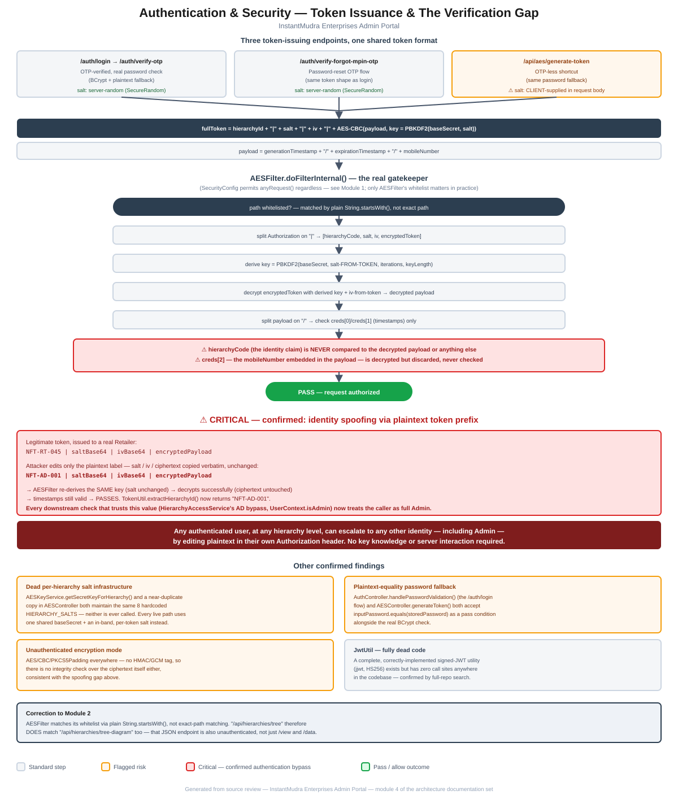

# Module 4: Authentication & Security

> Part of the InstantMudra Enterprises Admin Portal architecture documentation.
> Covers token issuance across all three login paths, `AESFilter`'s verification logic, and a confirmed critical authentication-bypass vulnerability.

## Figure 1 — Token issuance & verification flow diagram



*(Standalone version: [`04-authentication-security-flow.pdf`](04-authentication-security-flow.pdf) / [`.svg`](04-authentication-security-flow.svg))*

---

## 1. Token issuance — three endpoints, one shared format

All authenticated access is gated by a custom bearer-token scheme (not Spring Security, not the `JwtUtil`/JJWT dependency — see §5). Three endpoints issue a token in the same format, `hierarchyId|saltBase64|ivBase64|encryptedPayload`:

| Endpoint | Flow | Salt source |
|---|---|---|
| `POST /auth/login` → `POST /auth/verify-otp` | Password check ([`AuthController.handlePasswordValidation()`](../../src/main/java/com/im/admin/controller/AuthController.java)) → OTP sent → OTP verified → token issued | Server-generated (`aesEncryptionUtil.generateRandomSalt()`, backed by `SecureRandom`) |
| `POST /auth/verify-forgot-mpin-otp` | Password-reset OTP flow, same token-building code duplicated at a second call site | Server-generated |
| `POST /api/aes/generate-token` ([`AESController`](../../src/main/java/com/im/admin/controller/AESController.java)) | OTP-less shortcut — password check only, no OTP step | **Client-supplied** — taken directly from the request body (`tokenGenerationRequest.getSalt()`) |

All three build the token identically:

```java
long now = System.currentTimeMillis();
long exp = now + 3600_000L;
String payload = now + "/" + exp + "/" + user.getMobileNumber();
String encryptedToken = aesEncryptionUtil.encrypt(payload, secretKey, ivSpec);
String fullToken = user.getHierarchyId() + "|" + saltBase64 + "|" + ivBase64 + "|" + encryptedToken;
```

The encrypted **payload** contains the issue time, expiry time, and the user's mobile number. The **key** is derived via `PBKDF2WithHmacSHA256(baseSecret, salt, iterations, keyLength)`, where `baseSecret` is the single static secret from `application.properties` (`app.security.base-secret`, documented in [Module 1](01-core-bootstrap-config.md#31-applicationproperties-base--applies-to-every-profile)) and `salt` is whatever accompanies this specific token — server-random for the OTP flows, but **client-chosen** for `/api/aes/generate-token`.

---

## 2. Verification — `AESFilter`

[`AESFilter`](../../src/main/java/com/im/admin/config/AESFilter.java) is a `OncePerRequestFilter` and, per the top-level project documentation, the actual gatekeeper — `SecurityConfig`'s Spring Security filter chain permits `anyRequest()` unconditionally (see [Module 1](01-core-bootstrap-config.md#4-config-package--spring-configuration-classes)), so whatever `AESFilter` decides is what actually governs access.

For any path not on its whitelist, `doFilterInternal()`:

1. Reads the `Authorization: Bearer <token>` header.
2. Splits the token on `|` into exactly 4 parts: `hierarchyCode`, `saltBase64`, `ivBase64`, `encryptedToken`.
3. Base64-decodes the salt from the token and derives a key: `PBKDF2WithHmacSHA256(baseSecret, saltBytes, iterations, keyLength)` — **using the salt embedded in the presented token itself**, not a value looked up from `hierarchyCode` or from any server-side store.
4. Decrypts `encryptedToken` with that derived key and the IV from the token.
5. Splits the decrypted payload on `/` and reads only `creds[0]` (generation timestamp) and `creds[1]` (expiration timestamp) — checks that the current time hasn't passed `creds[1]`.
6. If not expired: **`filterChain.doFilter()` — request passes.**

That is the entirety of the check. `hierarchyCode` — the plaintext identity claim that every downstream authorization decision in the application relies on (`TokenUtil.extractHierarchyId()`, covered in [Module 2](02-hierarchy-access-model.md#41-hierarchyaccessservice)) — **is read from the header but never validated against the encrypted payload, the database, or anything else.** `creds[2]`, the mobile number embedded in the payload specifically to bind the token to a real user, is decrypted and then simply discarded — it is never compared to `hierarchyCode` or looked up against `UserDetails`.

### 2.1 Whitelist matching is `String.startsWith()`, not exact-path

`isPathViewableWithoutAuthentication()` checks `PATHS_VIEWABLE_WITHOUT_AUTHENTICATION.stream().anyMatch(path::startsWith)` — every whitelist entry acts as a **prefix**, not an exact match (unlike Spring Security's own `.requestMatchers(String...)` in `SecurityConfig`, which *is* exact-match for a plain string with no wildcard).

> **Correction to [Module 2](02-hierarchy-access-model.md#5-critical-finding-unauthenticated-hierarchyotpwallet-exposure):** that module stated `/api/hierarchies/tree-diagram` was "likely still gated by AESFilter" because the whitelist only contains the literal string `/api/hierarchies/tree` with no wildcard. That reasoning was based on Spring Security's own (exact) matching semantics and was written before this module traced `AESFilter`'s matching code directly. Since `AESFilter` uses plain `String.startsWith()`, `/api/hierarchies/tree` **does** match `/api/hierarchies/tree-diagram` (the latter literally starts with the former). **`GET /api/hierarchies/tree-diagram` is therefore also unauthenticated** — all three hierarchy endpoints (`/view`, `/data`, `/tree-diagram`) are public, not just two of three. This document (and the corresponding PDF) has been updated to reflect this.

---

## 3. Critical finding: identity spoofing via the plaintext token prefix

Because `hierarchyCode` is never bound to the encrypted payload, **any holder of any valid token can change who they claim to be by editing plaintext**, with no cryptographic consequence:

```
Legitimate token, issued to a real Retailer:
NFT-RT-045 | saltBase64 | ivBase64 | encryptedPayload

Attacker edits only the label before the first "|" — salt / iv / ciphertext copied verbatim:
NFT-AD-001 | saltBase64 | ivBase64 | encryptedPayload
```

Walking through `AESFilter` with the edited token: the salt is unchanged, so the same key is derived; the ciphertext is unchanged, so it decrypts successfully; the timestamps inside are unchanged and still valid — **the request passes**. `TokenUtil.extractHierarchyId()` then reads the edited header and returns `"NFT-AD-001"`. Every piece of downstream logic that trusts this value now believes the caller is that Admin account:

- `HierarchyAccessService.hasAccessToHierarchy()`'s `"AD"` bypass ([Module 2, §4.1](02-hierarchy-access-model.md#41-hierarchyaccessservice)) grants unrestricted access.
- `TokenUtil.getUserContext().isAdmin()` returns `true` for any `hierarchyId` whose type segment is `AD` or `SA`, purely from string-parsing the (attacker-controlled) header.
- Any controller that authorizes by comparing the caller's claimed `hierarchyId` against a target resource inherits the same trust.

**Net effect: any authenticated user, at any hierarchy level, can escalate to any other identity in the system — including full Admin — by editing three characters of plaintext in their own Authorization header. No knowledge of `baseSecret`, no re-encryption, and no additional server interaction is required.** This is a complete authentication/authorization bypass affecting every endpoint `AESFilter` is meant to protect, and is assessed as the single most severe finding across this documentation effort so far — more severe than the Module 2 unauthenticated-endpoint finding, because it doesn't require an endpoint to be misconfigured; it works against the intended, "working" authenticated path itself.

This should be treated as the top-priority remediation item to come out of the whole review. A minimal fix would have `AESFilter` re-derive or verify the identity claim from data actually inside the encrypted payload (e.g. look up the user by the decrypted mobile number and confirm their `hierarchyId` matches the header's claim) rather than trusting the plaintext label outright.

---

## 4. Other confirmed findings

### 4.1 Dead per-hierarchy salt infrastructure

Two separate places define an identical `HIERARCHY_SALTS` map (8 hardcoded per-level salts) and a `getSecretKeyForHierarchy(hierarchyCode)` method to use them: [`AESKeyService`](../../src/main/java/com/im/admin/config/AESKeyService.java) (a `@Service` bean) and a near-duplicate, independently-typed-out copy inside [`AESController`](../../src/main/java/com/im/admin/controller/AESController.java). A repository-wide search confirms **neither method is ever called** — every real login/verification path (§1–§2) derives its key from `baseSecret` plus a salt carried in-band with the token instead. This looks like an earlier, more deliberate design (fixed per-hierarchy salts, harder to spoof across levels) that was superseded by the current in-band-salt scheme without removing the old code.

### 4.2 Plaintext-equality password fallback

Confirmed at both password-checking call sites:

```java
// AuthController.handlePasswordValidation() — the primary /auth/login flow
boolean passwordMatches = passwordEncoder.matches(inputPassword, user.getLoginPassword());
boolean fallbackMatches = inputPassword.equals(user.getLoginPassword());
```
```java
// AESController.generateToken() — the OTP-less shortcut
boolean passwordOk = passwordEncoder.matches(decryptedPassword, storedPassword)
        || decryptedPassword.equals(storedPassword);
```

Both accept a **plain string-equality match** against the stored `loginPassword` as an alternative to the real BCrypt check. If any `UserDetails` row still holds a plaintext (unhashed) password — e.g. from data migrated before BCrypt was introduced, or written by some other code path that doesn't hash — login succeeds without ever exercising the BCrypt path. This matches and confirms the top-level finding precisely, at both locations it occurs.

### 4.3 Unauthenticated encryption mode

[`AESEncryptionUtil`](../../src/main/java/com/im/admin/util/AESEncryptionUtil.java) uses `AES/CBC/PKCS5Padding` throughout — a cipher mode with no built-in integrity check (no HMAC, no GCM authentication tag). This is consistent with, and part of the underlying reason for, §3: even if the plaintext-prefix issue were fixed, CBC alone doesn't protect the ciphertext or IV from tampering either — an authenticated mode (AES-GCM) or an HMAC-then-encrypt construction would be a stronger foundation for any redesign of this token scheme.

### 4.4 `JwtUtil` — fully dead code

[`JwtUtil`](../../src/main/java/com/im/admin/util/JwtUtil.java) is a complete, correctly-implemented signed-JWT helper (HS256 via the JJWT library already in `pom.xml` — see [Module 1](01-core-bootstrap-config.md#2-build-definition-pomxml)) with `generateToken()`, `extractClaim()`, and `validateToken()`. A repository-wide search confirms it has **zero call sites anywhere in the codebase** outside its own file. Notably, a real JWT — signed and tamper-evident by construction — would not have the identity-spoofing problem described in §3, since any modification to its claims would invalidate the signature. It's presumably a discarded earlier design.

---

## 5. Summary of risks specific to this module

1. **Critical — confirmed authentication/authorization bypass**: `AESFilter` never validates the `hierarchyId` claimed in a token's plaintext prefix against its encrypted contents, allowing any authenticated user to impersonate any other identity — including Admin — by editing their own Authorization header (§3). This is the top-priority finding of the entire review to date.
2. **`AESFilter`'s whitelist uses prefix matching (`String.startsWith()`)**, not exact-path matching — broader than it may appear at a glance, and the reason the Module 2 hierarchy-exposure finding needed correcting to include `/tree-diagram` as well (§2.1).
3. **Dead per-hierarchy salt infrastructure** duplicated in two places (`AESKeyService`, `AESController`), superseded by an in-band-salt design without cleanup (§4.1).
4. **Plaintext-equality password fallback** confirmed at both password-checking call sites (§4.2), matching the top-level finding precisely.
5. **Unauthenticated encryption mode (AES/CBC, no MAC/GCM)** used throughout the token scheme — a contributing factor to, though not the root cause of, the critical finding (§4.3).
6. **`JwtUtil` — a working, tamper-evident signed-JWT implementation — sits unused** while the actually-used custom scheme has the spoofing gap described above (§4.4).

These confirm and substantially deepen the "Authentication — not standard Spring Security" section of the top-level [`CLAUDE.md`](../../CLAUDE.md), and identify the most severe concrete vulnerability found in this documentation effort so far.

---

*Next module (pending your go-ahead): Multi-Vendor Integration Pattern (AEPS / DMT / Recharge-BBPS / Payment Gateway / Payout).*
