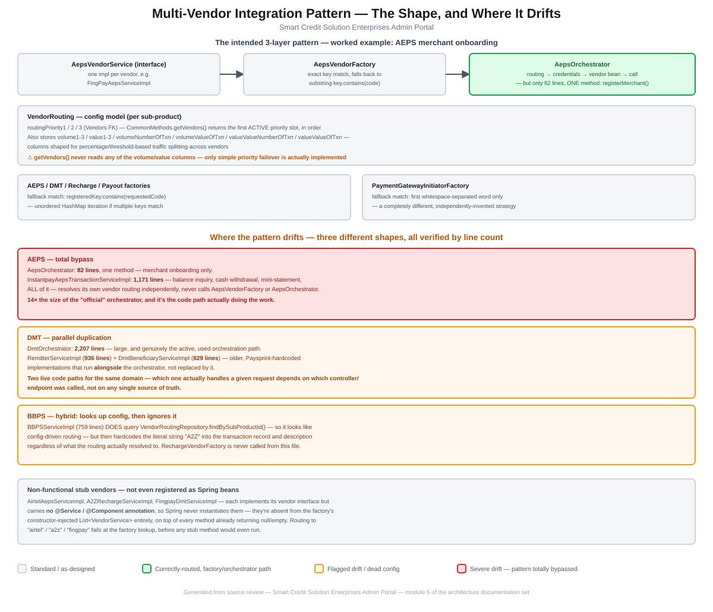

# Module 5: Multi-Vendor Integration Pattern

> Part of the InstantMudra Enterprises Admin Portal architecture documentation.
> Covers the intended vendor-impl → factory → orchestrator shape shared across AEPS, DMT, Recharge/BBPS, Payment Gateway, and Payout, the config model behind it, and exactly how — and how much — each domain drifts from it.

## Figure 1 — Pattern & drift diagram



*(Standalone version: [`05-vendor-integration-pattern-flow.pdf`](05-vendor-integration-pattern-flow.pdf) / [`.svg`](05-vendor-integration-pattern-flow.svg))*

---

## 1. The intended pattern — worked example: AEPS onboarding

Every external-vendor domain is meant to follow the same three-layer shape, per the top-level project documentation. AEPS merchant onboarding is small enough to show in full and illustrates it cleanly:

1. **Vendor-specific impl** — [`AepsVendorService`](../../src/main/java/com/im/admin/service/AepsVendorService.java) is the shared interface; each vendor (e.g. `FingPayAepsServiceImpl`) implements it.
2. **Factory** — [`AepsVendorFactory`](../../src/main/java/com/im/admin/util/AepsVendorFactory.java) is constructed with Spring's autowired `List<AepsVendorService>`, keyed by `getVendorCode().toLowerCase()`. `getVendor(vendorName)` tries an exact key match first, then falls back to `key.contains(code)` — a substring match over an unordered `HashMap`, so if two registered vendor codes both happen to contain the requested substring, which one wins is not deterministic.
3. **Orchestrator** — [`AepsOrchestrator`](../../src/main/java/com/im/admin/orchestrator/AepsOrchestrator.java) looks up `VendorRouting` for the requested sub-product, resolves the active vendor via `CommonMethods.getVendors()`, loads that vendor's `VendorCredentials`, asks the factory for the matching `AepsVendorService` bean, and calls it.

That's the whole class: **82 lines, a single method (`registerMerchant()`)**. This is the entire "official" AEPS orchestration surface — see §3 for what actually handles everything else in the AEPS domain.

---

## 2. `VendorRouting` — the config model behind vendor selection

[`VendorRouting`](../../src/main/java/com/im/admin/entities/VendorRouting.java) is keyed per sub-product and holds up to three prioritized vendor slots (`routingPriority1/2/3`, each an FK to `Vendors`). `CommonMethods.getVendors(VendorRouting)` walks them in order and returns the **first one flagged `active`**:

```java
if (vendorRouting.getRoutingPriority1() != null && vendorRouting.getRoutingPriority1().getActive())
    return vendorRouting.getRoutingPriority1();
else if (vendorRouting.getRoutingPriority2() != null && vendorRouting.getRoutingPriority2().getActive())
    return vendorRouting.getRoutingPriority2();
else if (vendorRouting.getRoutingPriority3() != null && vendorRouting.getRoutingPriority3().getActive())
    return vendorRouting.getRoutingPriority3();
throw new RuntimeException("No active vendor available for the requested configuration.");
```

This is simple, correct priority-failover — reasonable as far as it goes. But `VendorRouting` also carries a second set of columns that this method never reads at all: `volume1`/`volume2`/`volume3`, `value1`/`value2`/`value3`, `volumeNumberOfTxn`, `volumeValueOfTxn`, `valueValueNumberOfTxn`, `valueValueOfTxn`. Their naming strongly suggests they were designed for **percentage- or threshold-based traffic splitting** across the three priority vendors (e.g. "send 70% of volume to vendor 1, the rest to vendor 2" or "switch after N transactions / ₹X of value") — a materially more sophisticated routing model than what's actually implemented. As written, every request for a given sub-product goes to the same single active vendor until it's deactivated; the split-routing configuration a database admin might set in these columns has no effect on runtime behavior.

---

## 3. Two independently-invented fuzzy-matching strategies

Every domain factory needs to cope with vendor names not matching exactly between the database (`Vendors.vendorName`) and the Spring bean's declared code — but each one solved this differently, with no shared utility:

- **`AepsVendorFactory` / `DmtVendorFactory` / `RechargeVendorFactory` / `PayoutVendorFactory`** (`util/`) all use the same **substring-contains** fallback: `registeredKey.contains(requestedCode)`.
- **[`PaymentGatewayInitiatorFactory`](../../src/main/java/com/im/admin/paymentgateway/PaymentGatewayInitiatorFactory.java)** (`paymentgateway/`) uses a **completely different** fallback: match on the **first whitespace-separated word only** (`serviceFirstWord.equalsIgnoreCase(firstWord)`), and throws `RuntimeException` if nothing matches rather than returning `null` like the others.

Both approaches exist for the same underlying reason (DB-configured vendor names don't always match bean identifiers exactly), but neither shares code with the other, and the failure behavior differs (silent `null` vs. thrown exception) — a caller written against one factory's contract won't necessarily behave correctly against the other's.

---

## 4. Where the pattern drifts — three different shapes

### 4.1 AEPS — total bypass

`AepsOrchestrator` (82 lines, §1) handles **only merchant onboarding**. Every other AEPS operation — balance inquiry, cash withdrawal, mini-statement — is handled by [`InstantpayAepsTransactionServiceImpl`](../../src/main/java/com/im/admin/service/impl/InstantpayAepsTransactionServiceImpl.java), a **1,171-line**, fully self-contained implementation that resolves its own vendor routing independently and never calls `AepsVendorFactory` or `AepsOrchestrator` at all. The file doing the real work is **14× the size** of the "official" orchestration path — the orchestrator/factory pattern isn't a thin layer with one exception here, it's a small onboarding-only island next to the actual transaction engine.

### 4.2 DMT — parallel duplication

Unlike AEPS, [`DmtOrchestrator`](../../src/main/java/com/im/admin/orchestrator/DmtOrchestrator.java) is large (**2,207 lines**) and is genuinely the active orchestration path for DMT. But it runs **alongside**, not instead of, two older implementations: [`RemitterServiceImpl`](../../src/main/java/com/im/admin/service/impl/RemitterServiceImpl.java) (936 lines) and [`DmtBeneficiaryServiceImpl`](../../src/main/java/com/im/admin/service/impl/DmtBeneficiaryServiceImpl.java) (829 lines), both hardcoded to Paysprint rather than going through `DmtVendorFactory`. This is a different failure shape than AEPS's: two genuinely live code paths exist for overlapping DMT functionality, and which one a given request actually hits depends on which controller/endpoint it called — there's no single source of truth for "how DMT remitter/beneficiary registration works" in this codebase.

### 4.3 BBPS — hybrid: looks up config, then ignores it

[`BBPSServiceImpl`](../../src/main/java/com/im/admin/service/impl/BBPSServiceImpl.java) (759 lines) sits between the two patterns above. It **does** call `vendorRoutingRepository.findBySubProductId(...)` — so on the surface it looks config-driven — but then hardcodes the literal string `"A2Z"` into the constructed transaction record and description regardless of what that lookup actually resolved to:

```java
BbpsTranactionRequestDto bbpsTranactionRequestDto = new BbpsTranactionRequestDto(
    schemeRate, amount, walletType.name(), retailerId, gstValue, tdsValue,
    "PENDING", baseTransactionId, operator, subProducts.get().getSubProductTitle(),
    latitude, longitude, "A2Z", "Not Yet");
```

`RechargeVendorFactory` is never referenced anywhere in this file — the `VendorRouting` lookup determines *whether* to proceed, but not *which vendor implementation* actually handles the request; that's fixed to the A2Z-shaped flow regardless.

---

## 5. Non-functional stub vendors — not even registered as Spring beans

Three vendor implementations exist purely as empty shells: [`AirtelAepsServiceImpl`](../../src/main/java/com/im/admin/service/impl/AirtelAepsServiceImpl.java), [`A2ZRechargeServiceImpl`](../../src/main/java/com/im/admin/service/impl/A2ZRechargeServiceImpl.java), and [`FingpayDmtServiceImpl`](../../src/main/java/com/im/admin/service/impl/FingpayDmtServiceImpl.java) — every method returns `null` (or `Map.of()`/empty equivalents). Checking their class declarations directly confirms **none of the three carries a `@Service` or `@Component` annotation**:

```java
public class AirtelAepsServiceImpl implements AepsVendorService {
    @Override
    public CommonResponse<AepsMerchantResponseDto> onboardMerchant(AepsMerchantRequestDto request) {
        return null;
    }
    // every other method: return null;
}
```

Without a stereotype annotation, Spring never instantiates these as beans, so they're **absent entirely** from the factories' constructor-injected `List<VendorService>` — this goes a step further than "broken vendor implementation returning nulls": routing a request to `"airtel"`, `"a2z"`, or `"fingpay"` fails at the **factory lookup** itself (falls through to `null`/exception, per each factory's own contract from §3), before any of these classes' stub methods would ever execute. They're dead files, not reachable dead code.

---

## 6. Summary of risks specific to this module

1. **AEPS orchestration is 14× smaller than the code actually doing the work** — `AepsOrchestrator` (82 lines, onboarding only) vs. `InstantpayAepsTransactionServiceImpl` (1,171 lines, the real transaction engine, fully bypassing the intended pattern) (§4.1).
2. **DMT has two live, overlapping implementations** — a large, actively-used `DmtOrchestrator` (2,207 lines) alongside older Paysprint-hardcoded `RemitterServiceImpl`/`DmtBeneficiaryServiceImpl` (1,765 combined lines) that were never removed or merged (§4.2).
3. **BBPS pretends to be config-driven but isn't** — it queries `VendorRouting` but hardcodes the vendor-specific flow to `"A2Z"` regardless of the result, and never touches `RechargeVendorFactory` (§4.3).
4. **`VendorRouting`'s volume/value split-routing columns are fully dead** — `CommonMethods.getVendors()` implements only simple priority failover; any traffic-splitting configuration entered into those columns has zero runtime effect (§2).
5. **Two independently-invented, incompatible fuzzy-vendor-matching strategies** (substring-contains vs. first-word) across the five factories, with different failure behavior (silent `null` vs. thrown exception) (§3).
6. **Three vendor stub classes are entirely unreachable**, not just non-functional — missing `@Service`/`@Component` means they're never in the factory's bean list at all (§5).

These substantially deepen the "Multi-vendor integration pattern" section of the top-level [`CLAUDE.md`](../../CLAUDE.md), replacing its qualitative description with concrete, line-count-verified evidence of exactly how each domain's pattern drift is shaped differently.

---

*Next module (pending your go-ahead): to be decided — remaining candidates include Callbacks/Webhooks, Cron Jobs & Reconciliation, Dashboard & Aggregation, Fund Movement, KYC/eKYC, Notifications, Logging/Audit, Exception Handling, and Deployment.*
