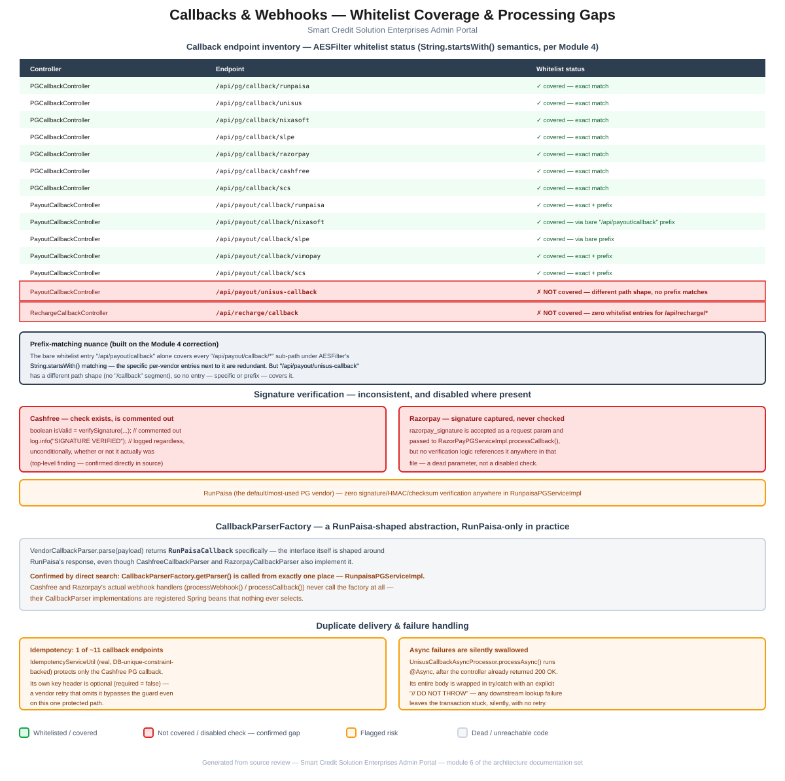

# Module 6: Callbacks & Webhooks

> Part of the Smart Credit Solution Enterprises Admin Portal architecture documentation.
> Covers every vendor callback endpoint's whitelist status (re-verified against `AESFilter`'s real matching semantics from Module 4), signature verification, the `CallbackParserFactory` abstraction, and duplicate-delivery/failure handling.

## Figure 1 — Whitelist coverage & processing gaps diagram



*(Standalone version: [`06-callbacks-webhooks-flow.pdf`](06-callbacks-webhooks-flow.pdf) / [`.svg`](06-callbacks-webhooks-flow.svg))*

---

## 1. Callback endpoint inventory

Vendor callbacks (async webhooks from payment gateways and payout providers) land in three controllers: [`PGCallbackController`](../../src/main/java/com/scs/admin/callbacks/PGCallbackController.java) (`/api/pg/callback/*`), [`PayoutCallbackController`](../../src/main/java/com/scs/admin/callbacks/PayoutCallbackController.java) (`/api/payout/*`), and [`RechargeCallbackController`](../../src/main/java/com/scs/admin/controller/RechargeCallbackController.java) (`/api/recharge/callback`). Since external vendors can't present an app-issued bearer token, every real callback path must be on `AESFilter`'s public whitelist — and [Module 4](04-authentication-security.md#21-whitelist-matching-is-stringstartswith-not-exact-path) established that whitelist is matched by plain `String.startsWith()`, not exact-path matching. Re-checking every callback endpoint against that actual semantics (rather than assuming exact-match, as the original top-level review did) gives:

| Endpoint | Whitelist status |
|---|---|
| `POST /api/pg/callback/{runpaisa, unisus, nixasoft, slpe, scs}` | ✓ covered — exact match on each specific entry |
| `GET /api/pg/callback/razorpay` | ✓ covered — exact match |
| `POST /api/pg/callback/cashfree` | ✓ covered — exact match |
| `POST /api/payout/callback/runpaisa` | ✓ covered — exact match, also within the bare `/api/payout/callback` prefix |
| `POST /api/payout/callback/{nixasoft, slpe}` | ✓ covered — **not** listed individually, but covered anyway by the bare `/api/payout/callback` prefix entry (see §1.1) |
| `POST /api/payout/callback/{vimopay, scs}` | ✓ covered — exact match, also within the bare prefix |
| `POST /api/payout/unisus-callback` | **✗ NOT covered** — confirmed real gap, see §1.1 |
| `POST /api/recharge/callback` | **✗ NOT covered** — confirmed real gap, no `/api/recharge/*` entry exists in either whitelist at all |

### 1.1 The prefix-matching nuance, and why one gap survives it

Because `AESFilter` treats every whitelist entry as a prefix, the single bare entry `"/api/payout/callback"` (present in both `SecurityConfig` and `AESFilter`'s lists) already covers **every** path starting with those characters — `/api/payout/callback/nixasoft`, `/api/payout/callback/slpe`, and so on — regardless of whether that specific sub-path also has its own explicit whitelist entry. The individually-listed entries (`/api/payout/callback/runpaisa`, `/api/payout/callback/vimopay`, `/api/payout/callback/scs`) are therefore redundant given how matching actually works.

**`/api/payout/unisus-callback` doesn't benefit from this**, because its path doesn't start with `/api/payout/callback` at all — it's `/api/payout/` followed directly by `unisus-callback`, not `/api/payout/callback/unisus`. No entry, specific or prefix, matches it. This is the same endpoint the top-level `CLAUDE.md` flagged as missing from both whitelists, and re-checking it against `AESFilter`'s actual prefix-matching behavior **confirms the gap is real** — unlike the Module 2 hierarchy-endpoint case, this is not a finding that needed correcting.

**`/api/recharge/callback` has no coverage at all**, under either exact or prefix matching — there is no whitelist entry anywhere starting with `/api/recharge`. A real vendor webhook (the `RechargeOrchestrator.processRechargeCallback("Cellmoney Recharge", ...)` call inside `RechargeCallbackController` confirms this is a live, expected integration point) hitting this endpoint has no `Authorization` header to present, so `AESFilter` would reject it with a 401 before it ever reaches `RechargeOrchestrator`. This looks like a genuine, currently-broken vendor integration rather than a design choice.

---

## 2. Signature verification — inconsistent, and disabled where present

Webhook signature verification exists in only one place, and it's turned off:

```java
// PGCallbackController.cashfreeCallback()
//        boolean isValid = verifySignature(rawPayload, signature, timestamp);
//
//        if (!isValid) {
//            log.error("SIGNATURE FAILED");
//            return ResponseEntity.status(400).body("Invalid signature");
//        }

log.info("SIGNATURE VERIFIED");   // logged unconditionally, regardless of whether any check ran
```

This confirms the top-level finding precisely, with the exact code: the verification call is commented out, but the success log line remains and fires every time regardless.

**Razorpay's callback accepts a signature but never checks it at all** — `handleRazorpayCallback()` takes `razorpay_signature` as a request parameter and passes it into `RazorPayPGServiceImpl.processCallback(...)`, but a direct search of that file shows the `signature` parameter is never referenced again after the method declaration — no verification logic exists for it anywhere. This is a step further than Cashfree's case: there isn't even a disabled check, just an unused parameter.

**RunPaisa — the default, most-used PG vendor — has zero signature/HMAC/checksum verification anywhere in `RunpaisaPGServiceImpl`**, confirmed by a full-file search for `signature`/`hmac`/`checksum` and related terms.

None of the callback controllers verify a shared secret, HMAC, or vendor-issued signature before acting on a payload. In practice this means anyone who can reach these public endpoints (and, per §1, most of them are intentionally public) can submit a syntactically-valid callback payload and have it processed as if it came from the real vendor — the primary check most of these paths rely on is that the referenced transaction/order ID already exists in `PgTransactionMapping`, not that the request genuinely originated from the vendor.

---

## 3. `CallbackParserFactory` — a RunPaisa-shaped abstraction, RunPaisa-only in practice

[`VendorCallbackParser`](../../src/main/java/com/scs/admin/service/VendorCallbackParser.java)'s `parse()` method returns `RunPaisaCallback` specifically — the interface itself is modeled on RunPaisa's response shape, even though [`CashfreeCallbackParser`](../../src/main/java/com/scs/admin/service/impl/CashfreeCallbackParser.java) and [`RazorpayCallbackParser`](../../src/main/java/com/scs/admin/service/impl/RazorpayCallbackParser.java) also implement it (meaning each must map its own vendor's payload shape into a `RunPaisaCallback`-shaped DTO).

A direct search confirms [`CallbackParserFactory.getParser()`](../../src/main/java/com/scs/admin/service/impl/CallbackParserFactory.java) is called from **exactly one place in the entire codebase: `RunpaisaPGServiceImpl`**. Cashfree's `processWebhook()` and Razorpay's `processCallback()` — the methods that actually handle those vendors' live callbacks (§2) — never reference the factory at all. `CashfreeCallbackParser` and `RazorpayCallbackParser` are registered Spring beans (available in the factory's autowired `List<VendorCallbackParser>`), but nothing in the request path for their own vendors ever asks the factory to select them. This mirrors the "abstraction exists, real traffic bypasses it" pattern already documented for the vendor-impl/factory/orchestrator shape in [Module 5](05-vendor-integration-pattern.md#4-where-the-pattern-drifts--three-different-shapes).

---

## 4. Duplicate delivery & failure handling

### 4.1 Idempotency protection covers 1 of ~11 callback endpoints

[`IdempotencyServiceUtil`](../../src/main/java/com/scs/admin/util/IdempotencyServiceUtil.java) is a genuinely well-built guard — it inserts an `idempotencyKey` into a table with a unique constraint and treats the resulting `DataIntegrityViolationException` as "already processed":

```java
public boolean tryAcquire(String idempotencyKey) {
    try {
        WebhookIdempotency entity = new WebhookIdempotency();
        entity.setIdempotencyId(idempotencyKey);
        entity.setCreatedAt(LocalDateTime.now());
        repository.save(entity);
        return true;
    } catch (DataIntegrityViolationException ex) {
        return false; // duplicate → already processed
    }
}
```

A direct search confirms this is called from **exactly one place**: the Cashfree PG callback. None of the other ten-or-so callback endpoints (RunPaisa/Unisus/NixaSoft/SLPE/Razorpay/SCS on the PG side; RunPaisa/NixaSoft/SLPE/VimoPay/SCS on the payout side; the Recharge callback) have any equivalent protection against a vendor's webhook retry being processed twice — whether that's actually safe depends entirely on each individual handler independently checking transaction status before re-applying a credit/debit, which is inconsistent to rely on given the wallet-locking gaps already documented in [Module 3](03-wallets-ledger.md#4-balance-update-path--no-locking-anywhere).

Even where it is used, the guard has a gap: the header that supplies `idempotencyKey` is declared `@RequestHeader(value = "x-idempotency-key", required = false)` — **optional**. A vendor retry that omits this header (or a vendor that never sends it at all) bypasses the protection entirely, since a `null`/absent key means `tryAcquire()` never has anything to collide against.

### 4.2 Async callback processing silently swallows failures

[`UnisusCallbackAsyncProcessor.processAsync()`](../../src/main/java/com/scs/admin/callbacks/UnisusCallbackAsyncProcessor.java) runs `@Async` — meaning the controller (`PGCallbackController.unisusCallback()`) has already returned `200 OK` to the vendor before this method's real work (looking up the transaction mapping, sub-product, scheme allocation, and forwarding to `TransactionEngineServiceImpl`) even executes. Its entire body is wrapped in a single `try`/`catch (Exception e)` with an explicit comment:

```java
} catch (Exception e) {
    log.error("Async processing failed for orderId: {}", trnRefNo, e);
    // DO NOT THROW
}
```

If any step fails — the `SchemeAllocation` isn't found, the `SubProducts` lookup misses, the scheme-combination hash parses incorrectly — the failure is logged and nothing else happens. The vendor already received a success acknowledgment, so it won't retry; there's no dead-letter table, no alert, no reconciliation entry created. The transaction silently never resolves unless someone notices it stuck in `PENDING` and investigates the logs by hand. This is a concrete instance of the pattern the top-level `CLAUDE.md` already flags at a higher level — "no reconciliation cron at all for AEPS or DMT" — showing the same "fire-and-forget with no safety net" shape inside the callback layer specifically.

---

## 5. Summary of risks specific to this module

1. **`/api/payout/unisus-callback` and `/api/recharge/callback` are confirmed missing from `AESFilter`'s whitelist** even under its actual prefix-matching semantics — real vendor webhooks to these paths are rejected as unauthenticated (§1).
2. **No callback endpoint verifies a vendor signature that's actually checked** — Cashfree's check is commented out (logging success regardless), Razorpay's signature parameter is captured but never used, and RunPaisa has no verification code at all (§2).
3. **`CallbackParserFactory`/`VendorCallbackParser` is used by exactly one vendor (RunPaisa)** despite two other vendors implementing the interface — the same "pattern exists, real traffic bypasses it" shape as Module 5's factory/orchestrator findings (§3).
4. **Duplicate-webhook protection exists for only 1 of ~11 callback endpoints**, and even that one's protection can be bypassed by omitting an optional header (§4.1).
5. **Async callback processing can fail silently with no retry or alert**, leaving transactions stuck in `PENDING` indefinitely with no vendor-visible signal (§4.2).

These add callback-specific detail to the "Multi-vendor integration pattern" and "Payments"/"Payouts" sections of the top-level [`CLAUDE.md`](../../CLAUDE.md), confirm one of its two named whitelist gaps precisely under the corrected `AESFilter` matching semantics from Module 4, and surface two new findings (the dead `CallbackParserFactory` usage and the silent-async-failure pattern) not previously catalogued.

---

*Next module (pending your go-ahead): remaining candidates include Cron Jobs & Reconciliation, Dashboard & Aggregation, Fund Movement, KYC/eKYC, Notifications, Logging/Audit, Exception Handling, and Deployment.*
