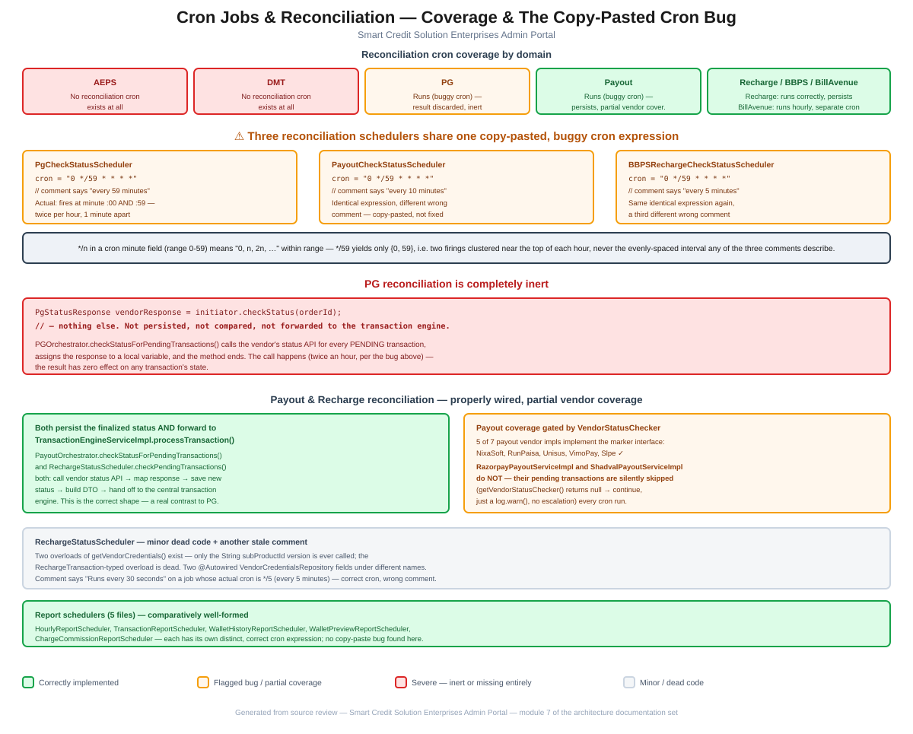

# Module 7: Cron Jobs & Reconciliation

> Part of the InstantMudra Enterprises Admin Portal architecture documentation.
> Covers every scheduled job in `cronJob/`, cross-domain reconciliation coverage, and a copy-pasted cron-expression bug shared by three of the status-check schedulers.

## Figure 1 — Coverage & the copy-pasted cron bug diagram



*(Standalone version: [`07-cron-jobs-reconciliation-flow.pdf`](07-cron-jobs-reconciliation-flow.pdf) / [`.svg`](07-cron-jobs-reconciliation-flow.svg))*

---

## 1. Reconciliation cron coverage by domain

`cronJob/` holds 10 scheduled jobs: 5 status-reconciliation schedulers (PG, Payout, Recharge/BBPS, and a separate BillAvenue one) and 5 report-generation schedulers. Checking which vendor domains actually have a reconciliation cron confirms the top-level finding directly — there is **no `AepsCheckStatusScheduler` or `DmtCheckStatusScheduler` anywhere in the package** (or the codebase generally). AEPS and DMT transactions that get stuck `PENDING` have no automated recovery path at all; PG, Payout, and Recharge/BBPS do, with the caveats below.

---

## 2. Three reconciliation schedulers share one copy-pasted, buggy cron expression

[`PgCheckStatusScheduler`](../../src/main/java/com/im/admin/cronJob/PgCheckStatusScheduler.java), [`PayoutCheckStatusScheduler`](../../src/main/java/com/im/admin/cronJob/PayoutCheckStatusScheduler.java), and [`BBPSRechargeCheckStatusScheduler`](../../src/main/java/com/im/admin/cronJob/BBPSRechargeCheckStatusScheduler.java) all use the **exact same cron expression**, each with a different, and each individually wrong, comment describing its interval:

```java
// PgCheckStatusScheduler
@Scheduled(cron = "0 */59 * * * *")  // every 59 minutes

// PayoutCheckStatusScheduler
@Scheduled(cron = "0 */59 * * * *")  // every 10 minutes

// BBPSRechargeCheckStatusScheduler
@Scheduled(cron = "0 */59 * * * *")  // every 5 minutes
```

The `*/n` step syntax in a cron minute field (valid range 0–59) generates the sequence `0, n, 2n, …` clipped to the field's range. For `n = 59`, that sequence is just `{0, 59}` — **the job fires twice per hour, at minute 0 and minute 59, one minute apart**, then waits roughly 59 minutes until the next pair. This matches none of the three comments' claimed intervals (59 minutes, 10 minutes, or 5 minutes) — the actual behavior is a distinct fourth thing none of them describe. The identical expression appearing in three unrelated files, each paired with a different wrong comment, is a strong signal that one scheduler was copied to create the other two without anyone updating (or correctly writing, in the first place) the cron expression itself.

This doesn't just mean "misleading comments" — the practical effect is that these three reconciliation jobs run in tight, clustered pairs near the top of each hour rather than at the evenly-spaced interval presumably intended, changing how quickly a stuck `PENDING` transaction actually gets picked up.

---

## 3. PG reconciliation is completely inert

The top-level project documentation notes that `PgCheckStatusScheduler` "fetches vendor status but discards it without persisting." Reading [`PGOrchestrator.checkStatusForPendingTransactions()`](../../src/main/java/com/im/admin/orchestrator/PGOrchestrator.java) directly confirms this precisely:

```java
public void checkStatusForPendingTransactions() {
    List<PgTransactionMapping> pendingList = pgTransactionMappingRepository.findByStatus("PENDING");

    for (PgTransactionMapping txn : pendingList) {
        try {
            PaymentGatewayInitiator initiator = factory.get(txn.getVendorName());
            PgStatusResponse vendorResponse = initiator.checkStatus(orderId);
            // — nothing else happens with vendorResponse
        } catch (Exception e) {
            log.error(...);
        }
    }
}
```

The vendor's status API is genuinely called for every pending PG transaction, but the response — `vendorResponse` — is assigned to a local variable and never read again: not compared against the transaction's current status, not persisted, not forwarded to `TransactionEngineServiceImpl`. Combined with §2's cron bug, this job makes a real outbound HTTP call to every configured PG vendor twice an hour, for every pending transaction, and the entire exercise has zero effect on any transaction's recorded state.

---

## 4. Payout & Recharge reconciliation — properly wired, with partial vendor coverage

In contrast to PG, both [`PayoutOrchestrator.checkStatusForPendingTransactions()`](../../src/main/java/com/im/admin/orchestrator/PayoutOrchestrator.java) and [`RechargeStatusScheduler.checkPendingTransactions()`](../../src/main/java/com/im/admin/cronJob/RechargeStatusScheduler.java) do the full job correctly: call the vendor's status-check API, map the response to a final status, **persist it**, build a `TransactionSchemeDetailsRequestDto`, and **forward it to `TransactionEngineServiceImpl.processTransaction()`** so the transaction (and any wallet effect) is actually finalized. This is the shape the PG job should have but doesn't.

Payout's coverage is gated by a marker interface, though:

```java
private VendorStatusChecker getVendorStatusChecker(VendorCredentials credentials) {
    Object vendorService = vendorFactory.getVendor(credentials.getVendor().getVendorName());
    if (vendorService instanceof VendorStatusChecker checker) {
        return checker;
    }
    log.warn("VendorStatusChecker not available for VendorName={}", ...);
    return null;
}
```

If the resolved vendor implementation doesn't implement `VendorStatusChecker`, the loop logs a warning and `continue`s — that vendor's pending payouts are silently skipped on every single cron run, with no escalation beyond the log line. Checking every payout vendor implementation directly:

| Vendor implementation | Implements `VendorStatusChecker`? |
|---|---|
| `NixaSoftPayoutServiceImpl` | ✓ |
| `RunPaisaPayoutServiceImplVO` | ✓ |
| `UnisusPayoutServiceImpl` | ✓ |
| `VimoPayoutServiceImpl` | ✓ |
| `SlpePayoutServiceImpl` | ✓ |
| `RazorpayPayoutServiceImpl` | **✗** |
| `ShadvalPayoutServiceImpl` | **✗** |

This confirms the top-level finding exactly — **Razorpay and Shadval payouts have no automated reconciliation** — with the full 5-of-7 vendor breakdown now enumerated. Notably, `RazorpayPayoutServiceImpl` is also the class the top-level review flags separately for `sendPayout()` incorrectly returning `null` on its success path (a Fund Movement/Payout-domain finding, out of scope for this module) — meaning Razorpay payouts have two independent, compounding reliability gaps in this codebase.

---

## 5. Minor: `RechargeStatusScheduler` dead code and another stale comment

Beyond the correctly-functioning reconciliation logic in §4, this file has some of its own small issues:

- **A dead method overload**: `getVendorCredentials(RechargeTransaction txn)` is declared but never called — the live code path uses a separate `getVendorCredentials(String subProductId)` overload instead. Both exist side-by-side in the same class.
- **Duplicate repository injection**: two separate `@Autowired VendorCredentialsRepository` fields (`vendorCredentialsRepository` and `credentialsRepository`) are declared under different names — the dead overload uses one, the live method uses the other.
- **Another stale comment**: `// Runs every 30 seconds` sits above `@Scheduled(cron = "0 */5 * * * *")` — the cron expression itself is correct here (fires every 5 minutes, no `*/59`-style bug), but the comment describing it is simply wrong, following the same "comment doesn't match code" pattern as §2, just without the shared-bug angle.

---

## 6. Report schedulers — comparatively well-formed

The five report-generation jobs — [`HourlyReportScheduler`](../../src/main/java/com/im/admin/cronJob/HourlyReportScheduler.java), [`TransactionReportScheduler`](../../src/main/java/com/im/admin/cronJob/TransactionReportScheduler.java), [`WalletHistoryReportScheduler`](../../src/main/java/com/im/admin/cronJob/WalletHistoryReportScheduler.java), [`WalletPreviewReportScheduler`](../../src/main/java/com/im/admin/cronJob/WalletPreviewReportScheduler.java), and [`ChargeCommissionReportScheduler`](../../src/main/java/com/im/admin/cronJob/ChargeCommissionReportScheduler.java) — each carry their own distinct, sensible cron expressions (hourly at `:05`, daily at `00:10`, hourly-during-business-hours at `1-23:00`, daily at `23:59`), with no copy-paste repetition found among them. Worth noting explicitly as a contrast: the bug in §2 is isolated specifically to the three PENDING-transaction status-check schedulers, not a codebase-wide carelessness with `@Scheduled` in general.

---

## 7. Summary of risks specific to this module

1. **Three reconciliation schedulers (PG, Payout, Recharge/BBPS) share one copy-pasted, buggy cron expression** (`0 */59 * * * *`) that fires twice per hour clustered near the top of the hour, matching none of the three different intervals their own comments claim (§2).
2. **PG reconciliation is completely inert** — the vendor status is fetched but never persisted, compared, or forwarded to the transaction engine, so the cron job runs for zero operational effect (§3).
3. **No reconciliation cron exists at all for AEPS or DMT** — confirmed by direct absence, matching the top-level finding (§1).
4. **Payout reconciliation silently skips Razorpay and Shadval** — the two of seven payout vendor implementations that don't implement `VendorStatusChecker`, with no escalation beyond a log warning on every run (§4).
5. **Minor dead code and a second stale comment** in `RechargeStatusScheduler`, isolated and low-impact compared to the findings above (§5).

These substantially deepen the "Status-check cron jobs" paragraph of the top-level [`CLAUDE.md`](../../CLAUDE.md), replacing its summary description with the exact shared root cause of the cron-timing issue, the precise vendor-by-vendor payout coverage table, and confirmation — with code — that the PG job's "fetches but discards" behavior is real.

---

*Next module (pending your go-ahead): remaining candidates include Dashboard & Aggregation, Fund Movement, KYC/eKYC, Notifications, Logging/Audit, Exception Handling, and Deployment.*
