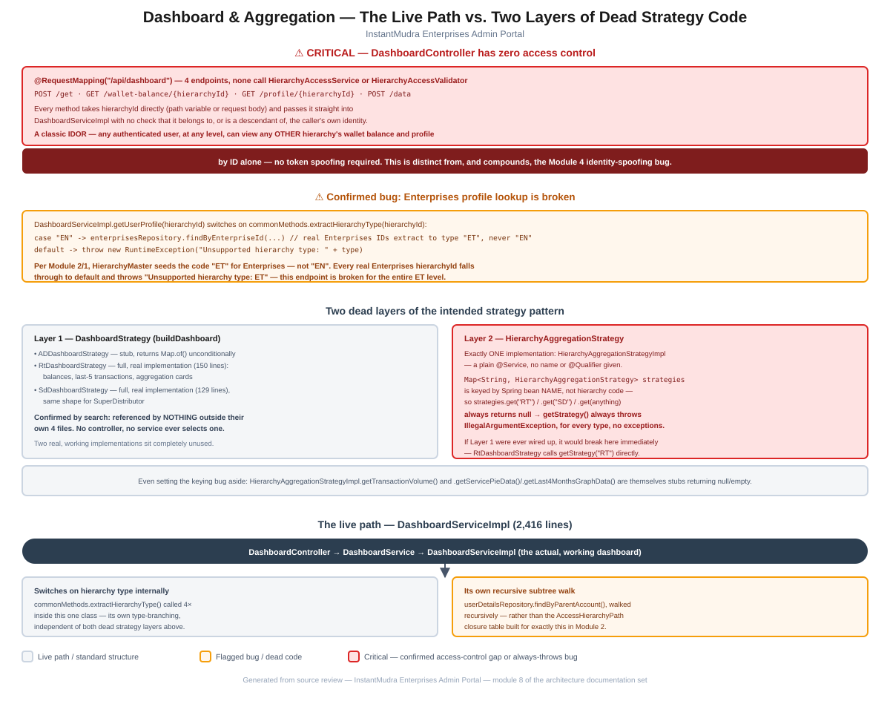

# Module 8: Dashboard & Aggregation

> Part of the InstantMudra Enterprises Admin Portal architecture documentation.
> Covers `DashboardController`'s access-control gap, a confirmed hierarchy-type-code bug, and the two dead layers of the intended `DashboardStrategy`/`HierarchyAggregationStrategy` pattern sitting alongside the live 2,416-line `DashboardServiceImpl`.

## Figure 1 — Live path vs. dead strategy layers diagram



*(Standalone version: [`08-dashboard-aggregation-flow.pdf`](08-dashboard-aggregation-flow.pdf) / [`.svg`](08-dashboard-aggregation-flow.svg))*

---

## 1. Critical: `DashboardController` has zero access control

[`DashboardController`](../../src/main/java/com/im/admin/controller/DashboardController.java) (`@RequestMapping("/api/dashboard")`) exposes four endpoints:

```java
@PostMapping("/get")                              public ResponseEntity<DashboardResponseDto> getAdminDashboard()
@GetMapping("/wallet-balance/{hierarchyId}")       public ResponseEntity<CommonResponse<WalletBalanceResponseDto>> getWalletBalances(@PathVariable String hierarchyId)
@GetMapping("/profile/{hierarchyId}")              public ResponseEntity<CommonResponse<MyProfileResponseDto>> getUserProfile(@PathVariable String hierarchyId)
@PostMapping("/data")                              public ResponseEntity<CommonResponse<Object>> getDashboardTransactions(@RequestBody DashboardTransactionRequest request)
```

A full read of the 77-line file confirms it — and its delegate, `DashboardServiceImpl` — **never reference `HierarchyAccessService` or `HierarchyAccessValidator`** ([Module 2](02-hierarchy-access-model.md#4-access-resolution)) at all. `getWalletBalances()` and `getUserProfile()` take `hierarchyId` straight from the URL path and pass it directly into `DashboardServiceImpl`, which in turn passes it straight into `CommonMethods.getCurrentBalance()` ([Module 3](03-wallets-ledger.md)) or a repository lookup — with no check anywhere that the requested `hierarchyId` belongs to, or is a descendant of, the caller's own identity.

This confirms the top-level project documentation's finding precisely, and it's worth being explicit about how it differs from the [Module 4](04-authentication-security.md#3-critical-finding-identity-spoofing-via-the-plaintext-token-prefix) identity-spoofing bug: that finding requires *forging* a token to claim a different identity. This one requires nothing of the sort — **a genuinely valid, un-spoofed token for the lowest-privilege account in the system is sufficient** to request `/api/dashboard/wallet-balance/{any-other-hierarchyId}` or `/api/dashboard/profile/{any-other-hierarchyId}` and get a real answer back. This is a textbook [IDOR](https://owasp.org/www-community/attacks/Insecure_Direct_Object_Reference) (Insecure Direct Object Reference), independent of and compounding the Module 4 finding.

---

## 2. Confirmed bug: Enterprises profile lookup is broken

Reading `DashboardServiceImpl.getUserProfile()` closely surfaces a concrete, type-code mismatch bug:

```java
String type = commonMethods.extractHierarchyType(hierarchyId);
switch (type) {
    case "AD"   -> { return adminRepository.findById(hierarchyId)...; }
    case "AU"   -> { return adminUserRepository.findById(hierarchyId)...; }
    case "EN"   -> { return enterprisesRepository.findByEnterpriseId(hierarchyId)...; }   // ← "EN"
    case "WL"   -> { ... }
    // ...
    default -> throw new RuntimeException("Unsupported hierarchy type: " + type);
}
```

Per [Module 1](01-core-bootstrap-config.md) and [Module 2](02-hierarchy-access-model.md#1-the-hierarchy-chain-and-its-seed-data), `HierarchyMasterDataInitializer` seeds the Enterprises code as **`"ET"`**, and every real Enterprises hierarchy ID (e.g. `ABC-ET-001`) extracts to type `"ET"` via `CommonMethods.extractHierarchyType()` — never `"EN"`. The `case "EN"` branch is therefore **unreachable for any real Enterprises account**; every genuine `ET`-type `hierarchyId` falls through to `default` and throws `RuntimeException("Unsupported hierarchy type: ET")`. **`GET /api/dashboard/profile/{hierarchyId}` is confirmed broken for the entire Enterprises hierarchy level.**

---

## 3. Two dead layers of the intended strategy pattern

The top-level documentation notes the `HierarchyAggregationStrategy`/`DashboardStrategy` rollup pattern is "largely dead code." Tracing both interfaces directly reveals **two separate, independently broken layers**, and the second is more thoroughly dead than the top-level summary implies.

### 3.1 Layer 1 — `DashboardStrategy` (per-level `buildDashboard()`)

Three implementations exist:

- [`ADDashboardStrategy`](../../src/main/java/com/im/admin/strategy/ADDashboardStrategy.java) — a genuine stub: `return Map.of();` unconditionally.
- [`RtDashboardStrategy`](../../src/main/java/com/im/admin/strategy/RtDashboardStrategy.java) — a **complete, real implementation** (150 lines): fetches the retailer's profile and wallet balances, its last 5 transactions, and builds aggregation cards.
- [`SdDashboardStrategy`](../../src/main/java/com/im/admin/strategy/SdDashboardStrategy.java) — likewise a **complete, real implementation** (129 lines), same shape for SuperDistributor.

A repository-wide search for `DashboardStrategy` confirms it appears in exactly **4 files: the interface and its 3 implementations, and nowhere else** — no controller, service, or selector map references any of them. Two fully-written, working dashboard builders sit completely unused.

### 3.2 Layer 2 — `HierarchyAggregationStrategy`

[`HierarchyAggregationService`](../../src/main/java/com/im/admin/strategy/HierarchyAggregationService.java) is a selector, structurally identical in spirit to the vendor factories from [Module 5](05-vendor-integration-pattern.md):

```java
private final Map<String, HierarchyAggregationStrategy> strategies;

public HierarchyAggregationStrategy getStrategy(String type) {
    HierarchyAggregationStrategy strategy = strategies.get(type);
    if (strategy == null) throw new IllegalArgumentException("Invalid type: " + type);
    return strategy;
}
```

There is exactly **one** implementation, [`HierarchyAggregationStrategyImpl`](../../src/main/java/com/im/admin/strategy/HierarchyAggregationStrategyImpl.java), declared as a plain `@Service` with **no bean name or `@Qualifier`** given. When Spring autowires a `Map<String, InterfaceType>`, it keys the map by **bean name**, not by any application-level identifier — so this map contains exactly one entry, keyed by the default bean name (`hierarchyAggregationStrategyImpl`), not by `"RT"`, `"SD"`, or any hierarchy code.

**The practical effect: `getStrategy(type)` throws `IllegalArgumentException` for every possible input, including `"RT"` and `"SD"`** — there is no type for which this lookup succeeds. This is a sharper finding than "only one aggregation strategy is ever registered, so looking one up by level throws for anything else" (the top-level phrasing, which could be read as implying one level works) — **none** do, because the single registered strategy isn't keyed by a hierarchy code at all.

This matters concretely for §3.1: `RtDashboardStrategy.buildDashboard()` calls `aggregationService.getStrategy("RT")` directly in its own "AGGREGATION" section. **If Layer 1 were ever wired up tomorrow** (a controller started calling it), it would immediately throw here — Layer 2's bug would surface the moment Layer 1's dead code became live.

Even setting the keying bug aside, `HierarchyAggregationStrategyImpl` itself is incomplete: `getTransactionVolume()` returns `null`, and `getLast4MonthsGraphData()`/`getServicePieData()` return empty collections — only `getCommission()`, `getRetailerCount()`, `getFundTransferred()`, and `getFundReceived()` are genuinely implemented.

---

## 4. The live path — `DashboardServiceImpl` (2,416 lines)

None of the above is what actually serves dashboard requests. [`DashboardServiceImpl`](../../src/main/java/com/im/admin/strategy/DashboardServiceImpl.java) — despite living in the same `strategy/` package as the dead classes above — is a single, large, monolithic implementation of the `DashboardService` interface that `DashboardController` actually calls. It:

- **Switches on hierarchy type internally**, independent of both dead layers above — `commonMethods.extractHierarchyType()` is called 4 separate times within this one class to branch behavior per level (confirmed at lines 236, 763, 2093, and 2132).
- **Implements its own recursive subtree walk** — `userDetailsRepository.findByParentAccount()`, called and walked recursively (`fetchChildrenRecursively()`, confirmed at line 1865) — rather than using the `AccessHierarchyPath` closure table built specifically for ancestor/descendant queries in [Module 2](02-hierarchy-access-model.md#22-accesshierarchynode--accesshierarchypath--a-real-closure-table). This is a second, independent implementation of "find every hierarchy under this one," alongside `HierarchyAccessService.resolveAccessibleHierarchyIds()` and `AccessHierarchyPathRepository.findAllDescendants()`, neither of which this file uses.

This confirms the top-level finding precisely: the dashboard that's actually live is this one large class, not the documented strategy pattern — and adds that it also duplicates tree-walking logic that already exists, correctly, elsewhere in the codebase.

---

## 5. Summary of risks specific to this module

1. **`DashboardController` has no access control on any endpoint** — a confirmed IDOR allowing any authenticated user to view any other hierarchy's wallet balance and profile by ID, with no token spoofing required (§1). This is the most severe finding in this module, and stacks with, rather than duplicates, the Module 4 authentication-bypass finding.
2. **`GET /api/dashboard/profile/{hierarchyId}` is confirmed broken for the entire Enterprises level** — a `"EN"` vs. `"ET"` type-code mismatch causes every real Enterprises account to hit the `default` branch and throw (§2).
3. **`HierarchyAggregationStrategy`'s lookup map always throws, for every hierarchy type, with no exceptions** — sharper than previously documented; the single registered implementation isn't keyed by any hierarchy code at all (§3.2).
4. **Two fully-written, real `DashboardStrategy` implementations (`RtDashboardStrategy`, `SdDashboardStrategy`) are completely unreferenced dead code**, and would immediately break on the Layer 2 bug above if ever wired up (§3.1, §3.2).
5. **The live `DashboardServiceImpl` re-implements hierarchy-type switching and subtree traversal independently**, rather than reusing the closure-table-backed utilities built for exactly that purpose in Module 2 (§4).

These substantially deepen the "Dashboard & Aggregation" paragraph of the top-level [`CLAUDE.md`](../../CLAUDE.md), replacing its summary with a precise account of exactly why the aggregation-strategy lookup fails for every input (not just "anything else"), and identify two new findings — the IDOR in `DashboardController` and the Enterprises type-code bug — not previously catalogued there.

---

*Next module (pending your go-ahead): remaining candidates include Fund Movement, KYC/eKYC, Notifications, Logging/Audit, Exception Handling, and Deployment.*
