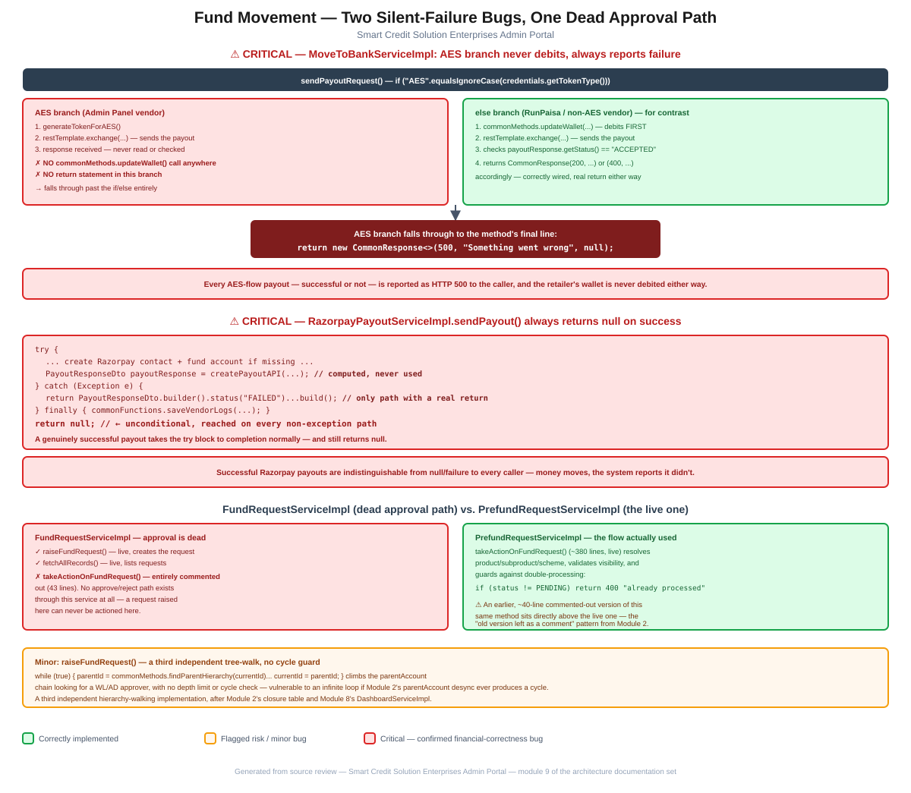

# Module 9: Fund Movement

> Part of the Smart Credit Solution Enterprises Admin Portal architecture documentation.
> Covers wallet-load ("fund request") approval and outbound payout ("move to bank") paths — two confirmed silent-failure bugs and one entirely dead approval flow.

## Figure 1 — Fund movement bugs & dead path diagram



*(Standalone version: [`09-fund-movement-flow.pdf`](09-fund-movement-flow.pdf) / [`.svg`](09-fund-movement-flow.svg))*

---

## 1. Critical: `MoveToBankServiceImpl`'s AES branch never debits, and always reports failure

[`MoveToBankServiceImpl.sendPayoutRequest()`](../../src/main/java/com/scs/admin/service/impl/MoveToBankServiceImpl.java) branches on the resolved vendor's credential type:

```java
if ("AES".equalsIgnoreCase(credentials.getTokenType())) {
    // AES Flow (Admin Panel)
    String token = generateTokenForAES(credentials);
    ...
    ResponseEntity<String> response = restTemplate.exchange(url, HttpMethod.POST, requestEntity, String.class);
    // — branch ends here. No wallet debit call. No response check. No return.

} else {
    AbstractWalletAmountTable walletAmountTable = commonMethods.getWalletByType(walletType.name(), sendPayoutRequest.getRetailerId());
    commonMethods.updateWallet(walletAmountTable, ..., "Debit", ...);   // debits BEFORE calling the vendor
    ...
    if (payoutResponse != null && "ACCEPTED".equalsIgnoreCase(payoutResponse.getStatus())) {
        return new CommonResponse<>(200, payoutResponse.getMessage(), payoutResponse);
    } else {
        return new CommonResponse<>(400, errorMsg, payoutResponse);
    }
}
```
```java
// after the if/else, still inside sendPayoutRequest():
return new CommonResponse<>(500, "Something went wrong", null);
```

The `else` branch (RunPaisa-style vendors) is correctly wired: debit the wallet, call the vendor, check the response, return an explicit success or failure. The `if` branch (AES/"Admin Panel" vendors) does neither of the last two things — it calls `commonMethods.updateWallet()` **nowhere**, never inspects the HTTP `response` it receives, and has **no `return` statement of its own**. Java's control flow falls out of the `if` block, past the `else`, to the method's final line — the same unconditional `return new CommonResponse<>(500, "Something went wrong", null);` that only exists as a defensive fallback.

**Confirmed effect: every payout routed through an AES-credential vendor is reported as HTTP 500 to the caller regardless of whether the vendor actually processed it, and the retailer's wallet is never debited in either case.** If the vendor genuinely moves money on a "successful" AES payout, the retailer's recorded wallet balance is now wrong (too high, since the debit that should have happened didn't) on top of the caller being told the request failed.

---

## 2. Critical: `RazorpayPayoutServiceImpl.sendPayout()` always returns `null` on success

This is the exact class and method the top-level project documentation flags ("`RazorpayPayoutServiceImpl.sendPayout()` falls through to `return null` on its success path"). Reading it directly confirms the precise shape of the bug:

```java
try {
    ... resolve or create the Razorpay beneficiary contact/fund account ...
    PayoutResponseDto payoutResponse = createPayoutAPI(beneficiary.getRazorpayFundAccountId(), req, creds, orderId);
    // — payoutResponse is never returned, never checked, never used again

} catch (Exception e) {
    return PayoutResponseDto.builder()
            .status("FAILED")
            .message("Razorpay error: " + e.getMessage())
            .build();

} finally {
    commonFunctions.saveVendorLogs(...);
}

return null;   // unconditional — reached whenever the try block completes without an exception
```

The **only** code path in this method that returns a populated `PayoutResponseDto` is the `catch` block — i.e., a genuine failure. A successful call to `createPayoutAPI()` runs the try block to normal completion, the `finally` block logs the vendor call, and execution reaches the bare `return null;` at the very end. **A successful Razorpay payout and an unexpected `null` are indistinguishable to every caller.** Whatever `PayoutOrchestrator` does with a `null` `PayoutResponseDto` (most likely treating it as a failure, per the top-level finding), the retailer is told their payout failed while the money has, in fact, moved — a direct cause of support burden and a real risk of a retailer or operator retrying a payout that already succeeded.

---

## 3. `FundRequestServiceImpl`'s approval path is entirely dead; `PrefundRequestServiceImpl` is the flow actually used

[`FundRequestServiceImpl`](../../src/main/java/com/scs/admin/service/impl/FundRequestServiceImpl.java) has exactly two live methods — `raiseFundRequest()` (creates a request, walking up the hierarchy to find an approver — see §4) and `fetchAllRecords()` (lists them). Its `takeActionOnFundRequest()` — the method that would actually approve or reject a request and move the money — is present only as **43 lines of commented-out code**:

```java
//    @Transactional
//    @Override
//    public void takeActionOnFundRequest(FundRequestActionDto actionDto) {
//        ...
//        if (newStatus == ConstantStatus.APPROVED) {
//            ...debit approver's wallet, credit requester's wallet...
//        }
//        fundRequestRepository.save(fundRequest);
//    }
```

**There is no way to approve or reject a `FundRequest` raised through this service — the class that creates requests cannot action them.** This confirms the top-level finding directly.

The flow that's actually live is [`PrefundRequestServiceImpl.takeActionOnFundRequest()`](../../src/main/java/com/scs/admin/service/impl/PrefundRequestServiceImpl.java) (~380 lines) — a real, substantial implementation that resolves the product/sub-product/scheme, validates sub-product visibility, and includes a sensible idempotency guard against double-processing:

```java
if (fundRequest.getStatus() != Status.PENDING) {
    return new CommonResponse<>(400, "Fund Request already processed", null);
}
```

Interestingly, **this file has its own copy of the same "dead code left as a comment" pattern already documented in [Module 2](02-hierarchy-access-model.md#41-hierarchyaccessservice)'s `HierarchyAccessService`**: an earlier, ~40-line commented-out version of `takeActionOnFundRequest()` sits directly above the live 380-line one in the same class. This appears to be a recurring habit in this codebase — superseded logic is commented out in place rather than deleted, whether or not the surrounding class is itself still live.

---

## 4. Minor: `raiseFundRequest()`'s parent-hierarchy walk has no cycle guard

`FundRequestServiceImpl.raiseFundRequest()` climbs the `parentAccount` chain looking for a `WL`- or `AD`-type approver:

```java
String currentId = fundRequestDto.getRequesterHierarchyId();
while (true) {
    Optional<String> parentOpt = commonMethods.findParentHierarchy(currentId);
    if (parentOpt.isEmpty()) {
        throw new RuntimeException("No approver found for hierarchy: " + ...);
    }
    String parentId = parentOpt.get();
    String parentType = commonMethods.extractHierarchyType(parentId);
    if ("WL".equals(parentType)) { ... if approver found, break; }
    if ("SCS".equals(parentType) || "AD".equals(parentType)) { ... if approver found, break; }
    currentId = parentId;
}
```

This loop has no maximum-depth limit and no cycle detection. [Module 2](02-hierarchy-access-model.md#23-the-sync-problem) already documents that `parentAccount` is a plain, unvalidated string field with no foreign key and no guarantee of consistency with the closure-table representation of the tree — if that field were ever misconfigured into a cycle (A's parent is B, B's parent is A), this loop would spin forever, holding the request thread (and, per the `@Transactional` annotation on `raiseFundRequest()`, a database transaction) open indefinitely. This is also the **third** independent hierarchy-tree-walking implementation found across this review, after `AccessHierarchyPathRepository`'s closure-table queries ([Module 2](02-hierarchy-access-model.md#22-accesshierarchynode--accesshierarchypath--a-real-closure-table)) and `DashboardServiceImpl`'s recursive `findByParentAccount()` walk ([Module 8](08-dashboard-aggregation.md#4-the-live-path--dashboardserviceimpl-2416-lines)).

---

## 5. Summary of risks specific to this module

1. **`MoveToBankServiceImpl`'s AES-credential payout branch never debits the wallet and always reports HTTP 500**, regardless of whether the vendor actually processed the payout — confirmed with the exact fall-through code path (§1). This is a direct financial-correctness bug with no workaround short of a code fix.
2. **`RazorpayPayoutServiceImpl.sendPayout()` always returns `null` on its success path**, so every successful Razorpay payout is reported upstream as if it failed — confirmed precisely, matching and detailing the top-level finding (§2).
3. **`FundRequestServiceImpl` cannot approve or reject the fund requests it creates** — the entire approval method is commented out; `PrefundRequestServiceImpl` is confirmed as the real, live approval path in current use (§3).
4. **`raiseFundRequest()`'s hierarchy-parent-search loop has no cycle or depth guard**, and is a third independent reimplementation of hierarchy tree-walking already seen twice elsewhere in this review (§4).

Two of the four findings in this module (§1, §2) are financial-correctness bugs with concrete, confirmed code paths — on the same severity tier as the [Module 3](03-wallets-ledger.md#5-critical-finding-confirmed-bug-in-multi-level-reversal) wallet-reversal bug, and worth prioritizing alongside it. These substantially deepen the "Fund movement" bullet in the top-level [`CLAUDE.md`](../../CLAUDE.md) known-issues list, which had named both classes but not traced the exact control-flow shape of either bug.

---

*Next module (pending your go-ahead): remaining candidates include KYC/eKYC, Notifications, Logging/Audit, Exception Handling, and Deployment.*
