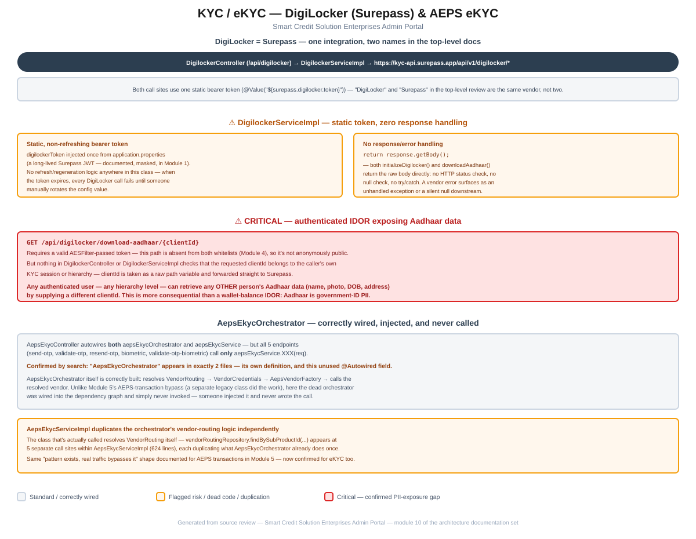

# Module 10: KYC / eKYC

> Part of the Smart Credit Solution Enterprises Admin Portal architecture documentation.
> Covers the DigiLocker (Surepass) integration and AEPS eKYC — a confirmed authenticated IDOR exposing Aadhaar data, and a dead orchestrator sitting unused right next to the service that actually runs.

## Figure 1 — DigiLocker & AEPS eKYC flow diagram



*(Standalone version: [`10-kyc-ekyc-flow.pdf`](10-kyc-ekyc-flow.pdf) / [`.svg`](10-kyc-ekyc-flow.svg))*

---

## 1. DigiLocker = Surepass — one integration, not two

The top-level project documentation lists "DigiLocker, Surepass, and various KYC/eKYC vendor integrations" as if they were separate items. Reading [`DigilockerServiceImpl`](../../src/main/java/com/scs/admin/service/impl/DigilockerServiceImpl.java) directly clarifies that **DigiLocker access in this codebase is provided entirely through the Surepass API** (`https://kyc-api.surepass.app/api/v1/digilocker/*`), authenticated with the single bearer token configured as `surepass.digilocker.token` — the same live JWT documented (and masked) in [Module 1](01-core-bootstrap-config.md#31-applicationproperties-base--applies-to-every-profile). There is no separate, direct DigiLocker government API integration in this codebase; "DigiLocker" here means "DigiLocker data, via Surepass."

[`DigilockerController`](../../src/main/java/com/scs/admin/controller/DigilockerController.java) (`@RequestMapping("/api/digilocker")`) exposes two endpoints — `POST /initialize` and `GET /download-aadhaar/{clientId}` — both delegating straight through to this one service.

---

## 2. `DigilockerServiceImpl` — a static token with no refresh, and no response handling

```java
@Value("${surepass.digilocker.token}")
private String digilockerToken;

@Override
public DigilockerInitResponse initializeDigilocker() {
    HttpHeaders headers = new HttpHeaders();
    headers.setBearerAuth(digilockerToken);
    ...
    ResponseEntity<DigilockerInitResponse> response = restTemplate.exchange(INIT_URL, HttpMethod.POST, entity, DigilockerInitResponse.class);
    return response.getBody();
}
```

Two things worth flagging:

- **The bearer token is a single, static configuration value with no refresh or regeneration logic anywhere in this class.** JWTs of this kind carry an expiry; when this one lapses, every DigiLocker call (initialization and Aadhaar download alike) will start failing until someone manually rotates `surepass.digilocker.token` in `application.properties` — there's no automated renewal path to catch this in advance.
- **Neither method checks the HTTP response before returning it.** `response.getBody()` is returned directly in both `initializeDigilocker()` and `downloadAadhaar()`, with no status-code check, no null check, and no `try`/`catch`. A Surepass-side error (rate limit, expired token, invalid client) either propagates as an unhandled `RestClientException` (surfacing to the caller as a raw 500) or returns a silently empty/null response body, depending on exactly how it fails — there's no graceful degradation or clear error message either way.

---

## 3. Critical: an authenticated IDOR exposing Aadhaar data

```java
@GetMapping("/download-aadhaar/{clientId}")
public ResponseEntity<CommonResponse<DigilockerAadhaarResponse>> downloadAadhaar(@PathVariable String clientId) {
    DigilockerAadhaarResponse response = digilockerService.downloadAadhaar(clientId);
    return ResponseEntity.ok(CommonResponse.success(response, "Aadhaar fetched successfully"));
}
```

Checking `/api/digilocker/**` against both whitelists from [Module 4](04-authentication-security.md#21-whitelist-matching-is-stringstartswith-not-exact-path) confirms it's **absent from both** — this endpoint is not anonymously public; a valid `AESFilter`-passed token is required to reach it at all.

**But nothing downstream of that check verifies that the requested `clientId` belongs to the caller.** `clientId` is taken directly as a path variable and forwarded to Surepass with no cross-check against the caller's own KYC session, retailer record, or hierarchy ID. The same IDOR shape already confirmed twice elsewhere in this review ([Module 2](02-hierarchy-access-model.md#5-critical-finding-unauthenticated-hierarchyotpwallet-exposure)'s hierarchy tree, [Module 8](08-dashboard-aggregation.md#1-critical-dashboardcontroller-has-zero-access-control)'s dashboard) shows up here again — **any authenticated user, at any hierarchy level, can retrieve any other person's Aadhaar data** (name, photograph, date of birth, address — the full DigiLocker Aadhaar record) by supplying a different `clientId`. This is arguably more consequential than the wallet-balance IDORs found elsewhere: Aadhaar is government-issued identity PII, and its exposure carries regulatory as well as reputational weight beyond a financial figure.

---

## 4. `AepsEkycOrchestrator` — correctly wired, injected, and never called

[`AepsEkycController`](../../src/main/java/com/scs/admin/controller/AepsEkycController.java) autowires **both** `AepsEkycOrchestrator` and `AepsEkycService`:

```java
@Autowired
private AepsEkycOrchestrator aepsEkycOrchestrator;

@Autowired
private AepsEkycService aepsEkycService;

@PostMapping("/send-otp")
public ResponseEntity<CommonResponse<AepsEkycResponseDto>> sendOtp(@RequestBody AepsSendOtpRequest req) {
    return aepsEkycService.sendOtp(req);   // not aepsEkycOrchestrator
}
// same pattern for validate-otp, resend-otp, biometric, validate-otp-biometric
```

All five endpoints in the controller call `aepsEkycService` exclusively. A repository-wide search confirms `AepsEkycOrchestrator` is referenced in **exactly two files: its own definition, and this unused `@Autowired` field** — it's never actually invoked anywhere.

[`AepsEkycOrchestrator`](../../src/main/java/com/scs/admin/service/impl/AepsEkycOrchestrator.java) itself is a **correctly-built** implementation of the intended pattern from [Module 5](05-vendor-integration-pattern.md#1-the-intended-pattern--worked-example-aeps-onboarding): resolve `VendorRouting` → resolve `VendorCredentials` → resolve the vendor bean via `AepsVendorFactory` → call it, for all five eKYC operations. This makes it a slightly different flavor of the "pattern bypassed" finding than Module 5's AEPS transactions: there, a completely separate 1,171-line legacy class did the real work. Here, the correctly-built orchestrator was wired directly into the controller's dependency graph — someone added the `@Autowired` field — and then the actual method calls were simply never written against it.

---

## 5. `AepsEkycServiceImpl` independently duplicates the orchestrator's vendor-routing logic

The class that's actually called, [`AepsEkycServiceImpl`](../../src/main/java/com/scs/admin/service/impl/AepsEkycServiceImpl.java) (624 lines), resolves `VendorRouting` itself rather than deferring to the orchestrator sitting unused next to it in the controller:

```java
VendorRouting vendorRouting = vendorRoutingRepository.findBySubProductId(req.getSubProductId());
```

This exact call appears **five separate times** within the file — once per eKYC operation — each independently duplicating the single resolution `AepsEkycOrchestrator` already implements once. This is the same "pattern exists, real traffic bypasses it" shape documented for AEPS transactions in Module 5, now confirmed in the eKYC sub-domain as well, with the added detail that the duplication here happens five times over within one class rather than once in a separate legacy file.

---

## 6. Summary of risks specific to this module

1. **`GET /api/digilocker/download-aadhaar/{clientId}` is a confirmed authenticated IDOR exposing Aadhaar data** — any valid session, regardless of hierarchy level, can retrieve any other individual's Aadhaar record by ID (§3). This is the most severe finding in this module, and a new finding not previously catalogued at the top level.
2. **The Surepass DigiLocker bearer token is static with no refresh path**, and neither DigiLocker method checks its HTTP response before returning it — vendor-side errors surface as unhandled exceptions or silent nulls (§2).
3. **`AepsEkycOrchestrator` is fully dead code** despite being correctly built and directly injected into the one controller that could use it — confirmed by its two-file reference count (§4).
4. **`AepsEkycServiceImpl` re-resolves `VendorRouting` independently at five separate call sites**, duplicating logic the unused orchestrator already centralizes once (§5).

These clarify the top-level [`CLAUDE.md`](../../CLAUDE.md)'s KYC/eKYC mention (correcting "DigiLocker, Surepass" from two integrations to one), extend the Module 5 "pattern exists, real traffic bypasses it" finding into a new domain, and surface a new, high-severity PII-exposure finding not previously documented.

---

*Next module (pending your go-ahead): remaining candidates include Notifications, Logging/Audit, Exception Handling, and Deployment.*
