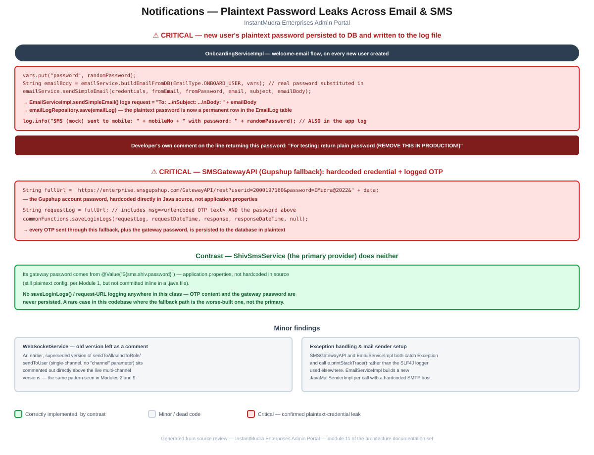

# Module 11: Notifications

> Part of the Smart Credit Solution Enterprises Admin Portal architecture documentation.
> Covers email, SMS, and WebSocket notification paths — two confirmed plaintext-credential leaks (a new user's own password, and an SMS gateway's account password) persisted into database logs and application log files.

## Figure 1 — Notification credential-leak diagram



*(Standalone version: [`11-notifications-flow.pdf`](11-notifications-flow.pdf) / [`.svg`](11-notifications-flow.svg))*

---

## 1. Critical: a new user's plaintext password is persisted to the database and written to the log file

`OnboardingServiceImpl`'s user-creation flow builds and sends a welcome email, then logs its own summary of what happened:

```java
Map<String, String> vars = new HashMap<>();
vars.put("name", name);
vars.put("mobile", mobileNo);
vars.put("password", randomPassword);

String emailBody = emailService.buildEmailFromDB(EmailType.ONBOARD_USER, vars);

emailService.sendSimpleEmail(credentials, fromEmail, fromPassword, email, "Welcome to SCS – Your Login Credentials", emailBody);

log.info("User created for hierarchy: " + hierarchyType + ", mobile: " + mobileNo);
log.info("SMS (mock) sent to mobile: " + mobileNo + " with password: " + randomPassword);
```

`emailBody` is built from a database template with the real `randomPassword` substituted directly into the `{{password}}` placeholder — this is the literal plaintext password for the newly created account. Following it into [`EmailServiceImpl.sendSimpleEmail()`](../../src/main/java/com/scs/admin/service/impl/EmailServiceImpl.java):

```java
public void sendSimpleEmail(EmailCredentialsMaster credentials, String fromEmail, String fromPassword, String toEmail, String subject, String body) {
    String request = "To: " + toEmail + "\nSubject: " + subject + "\nBody: " + body;
    ...
    EmailLog emailLog = new EmailLog();
    emailLog.setRequest(request);
    ...
    emailLogRepository.save(emailLog);
}
```

**The full email body — including the new user's plaintext password — is written into the `EmailLog` database table on every single onboarding.** Independently, the second `log.info(...)` call above writes the same plaintext password **directly into the application's log file** as well — a second, separate leak of the identical secret, via a completely different code path in the same method.

The method's own final line carries a comment that removes any doubt this was an accepted risk rather than a deliberate design choice:

```java
// For testing: return plain password (REMOVE THIS IN PRODUCTION!)
return randomPassword;
```

A commented-out line just above (`//smsService.sendSms(mobile, "Your account has been created. Password: " + randomPassword);`) shows the same pattern was also planned for SMS delivery, though that specific call is currently inert.

---

## 2. Critical: `SMSGatewayAPI` (Gupshup fallback) hardcodes a live credential and logs OTPs in plaintext

[`SMSGatewayAPI.sendOTPSms()`](../../src/main/java/com/scs/admin/commons/SMSGatewayAPI.java) — the Gupshup-based fallback referenced in the top-level project documentation — builds its request URL like this:

```java
String requestMessage = "Your One Time Password is " + otp + " -Smart Credit Solution.";
String encodedMsg = URLEncoder.encode(requestMessage, StandardCharsets.UTF_8);
String data = "send_to=" + mobileNumber + "&method=sendMessage&msg=" + encodedMsg + "&...";

String fullUrl = "https://enterprise.smsgupshup.com/GatewayAPI/rest?userid=<user-id>&password=<password>&" + data;
```

The Gupshup account password is **hardcoded directly in the Java source** — not `application.properties` like the credentials documented in [Module 1](01-core-bootstrap-config.md#31-applicationproperties-base--applies-to-every-profile), but committed inline in a `.java` file. Immediately after building this URL:

```java
String requestLog = fullUrl;
...
commonFunctions.saveLoginLogs(requestLog, requestDateTime, response, responseDateTime, null);
```

`requestLog` is the complete URL, including the URL-encoded OTP text and the hardcoded Gupshup password — and it's persisted via `commonFunctions.saveLoginLogs()`. **Every OTP sent through this fallback path is stored in plaintext in the database, alongside the gateway account's own password, for as long as that log table is retained.**

---

## 3. Contrast: `ShivSmsService`, the primary provider, does neither of these things

[`ShivSmsService`](../../src/main/java/com/scs/admin/commons/ShivSmsService.java) is the SMS provider actually used first (per the top-level documentation's "primary" framing), and checking it directly shows it avoids both problems found in its own fallback:

- Its gateway password is sourced from `@Value("${sms.shiv.password}")` — plaintext in `application.properties` (already a documented risk from Module 1), but **not hardcoded inline in source** the way `SMSGatewayAPI`'s is.
- A full-file search finds **no `saveLoginLogs()` call or request-URL logging anywhere in this class** — OTP content and the gateway credential are never written to a persistent log.

This is a notable, if narrow, positive finding: in this specific pair of implementations, the **fallback path is measurably worse-built than the primary one** it's meant to stand in for — an unusual direction for this kind of gap, since fallbacks are more commonly the neglected half.

---

## 4. Minor findings

- **`WebSocketService`** carries an earlier, fully commented-out version of `sendToAll()`/`sendToRole()`/`sendToUser()` (a single-channel design, superseded by the live multi-channel versions) sitting directly above the code that's actually used — the same "old version left as a comment" habit already documented in [Module 2](02-hierarchy-access-model.md#41-hierarchyaccessservice) (`HierarchyAccessService`) and [Module 9](09-fund-movement.md#3-fundrequestserviceimpls-approval-path-is-entirely-dead-prefundrequestserviceimpl-is-the-flow-actually-used) (`PrefundRequestServiceImpl`).
- **Inconsistent exception handling**: both `SMSGatewayAPI` and `EmailServiceImpl` catch `Exception e` and call `e.printStackTrace()` rather than using the SLF4J `log.error(...)` pattern used consistently elsewhere in the codebase — these failures go to stdout/stderr rather than wherever the application's structured logs are actually aggregated.
- **`EmailServiceImpl.sendSimpleEmail()` constructs a brand-new `JavaMailSenderImpl` on every call**, using the SMTP host and port saved in Email Credentials — functional, but and slightly wasteful compared to a single configured Spring-managed mail sender bean.

---

## 5. Summary of risks specific to this module

1. **A new user's plaintext password is persisted twice on every onboarding** — once into the `EmailLog` database table via the welcome-email logging path, and once into the application log file via a direct `log.info(...)` call — confirmed with the developer's own "REMOVE THIS IN PRODUCTION!" comment as corroborating evidence (§1). This is the most severe finding in this module.
2. **`SMSGatewayAPI` hardcodes a live SMS gateway password in source and persists every OTP it sends, in plaintext, to the database** via the same logging call used for legitimate audit purposes elsewhere (§2).
3. **`ShivSmsService`, the primary SMS provider, avoids both problems** — a rare case where the fallback path is the weaker-built one (§3).
4. **Minor code-hygiene issues**: a commented-out dead `WebSocketService` implementation, inconsistent exception logging via `printStackTrace()`, and a per-call, hardcoded-host `JavaMailSenderImpl` (§4).

These substantially deepen the "Email ... and SMS ... for OTP/notifications" mention in the top-level [`CLAUDE.md`](../../CLAUDE.md), and surface two new, high-severity plaintext-credential-exposure findings — both independently confirmed with exact source lines — not previously catalogued there.

---

*Next module (pending your go-ahead): remaining candidates include Logging/Audit, Exception Handling, and Deployment.*
