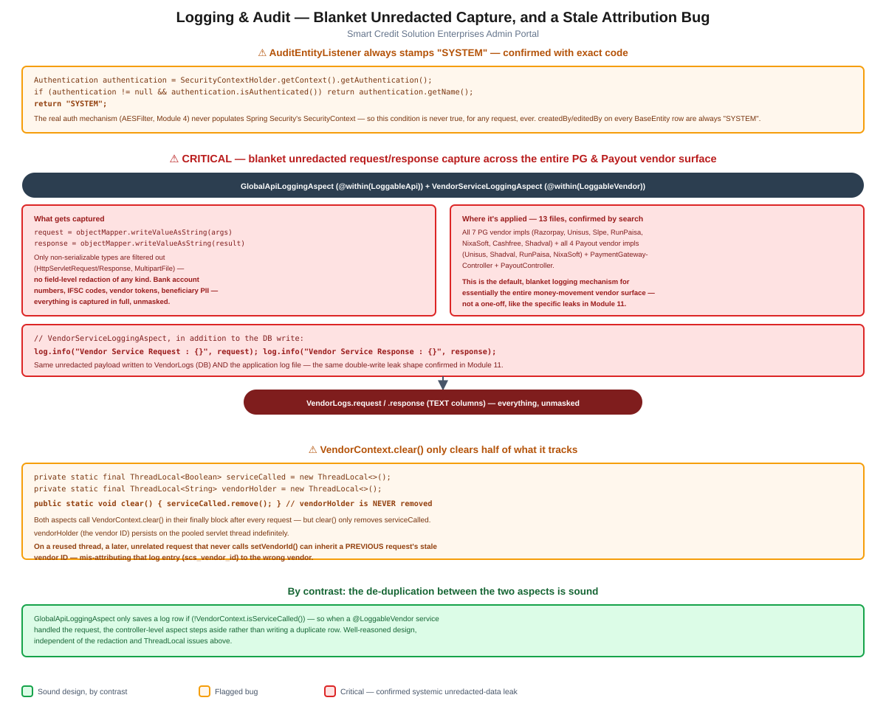

# Module 12: Logging & Audit

> Part of the Smart Credit Solution Enterprises Admin Portal architecture documentation.
> Covers `AuditEntityListener`, the AOP-based `GlobalApiLoggingAspect`/`VendorServiceLoggingAspect` request/response logging, and a `ThreadLocal` cleanup bug — generalizing Module 11's specific plaintext-credential leaks into a systemic, codebase-wide default.

## Figure 1 — Blanket capture & stale-attribution diagram



*(Standalone version: [`12-logging-audit-flow.pdf`](12-logging-audit-flow.pdf) / [`.svg`](12-logging-audit-flow.svg))*

---

## 1. `AuditEntityListener` always stamps `"SYSTEM"` — confirmed with exact code

The top-level project documentation notes that `AuditEntityListener`'s `createdBy`/`editedBy` stamping always resolves to `"SYSTEM"`. Reading it directly confirms exactly why:

```java
private String getAuthenticatedUsername() {
    Authentication authentication = SecurityContextHolder.getContext().getAuthentication();
    if (authentication != null && authentication.isAuthenticated()) {
        return authentication.getName();
    }
    return "SYSTEM";
}
```

This reads from Spring Security's `SecurityContextHolder` — but the application's real authentication mechanism, `AESFilter` ([Module 4](04-authentication-security.md#2-verification--aesfilter)), is a plain servlet filter that never populates that context. The `if` condition here is therefore never true, for any request, under any circumstances — `getAuthenticatedUsername()` always falls through to `"SYSTEM"`. Every `createdOn`/`createdBy`/`editedOn`/`editedBy` value on every entity extending `BaseEntity` ([Module 2](02-hierarchy-access-model.md#3-profile-entities--shape-and-inconsistencies)) is attributed to `"SYSTEM"` regardless of which hierarchy account actually performed the action — audit trails in this codebase cannot answer "who did this" for any `BaseEntity`-backed table.

---

## 2. Critical: blanket, unredacted request/response logging across the entire PG & Payout vendor surface

Two AOP aspects, triggered by marker annotations, capture full method arguments and return values:

```java
// GlobalApiLoggingAspect — @within(LoggableApi)
Object[] safeArgs = Arrays.stream(joinPoint.getArgs())
        .filter(arg -> !(arg instanceof HttpServletRequest))
        .filter(arg -> !(arg instanceof HttpServletResponse))
        .filter(arg -> !(arg instanceof MultipartFile))
        .toArray();
request = objectMapper.writeValueAsString(safeArgs);
...
response = result != null ? objectMapper.writeValueAsString(result) : "null";
```

```java
// VendorServiceLoggingAspect — @within(LoggableVendor)
request = objectMapper.writeValueAsString(filteredArgs);
log.info("Vendor Service Request : {}", request);
...
response = ...;
log.info("Vendor Service Response : {}", response);
```

Both aspects filter out only **non-serializable object types** (`HttpServletRequest`/`Response`, `MultipartFile`) — there is **no field-level redaction of any kind**. Whatever data the annotated method receives or returns is serialized whole and persisted into [`VendorLogs`](../../src/main/java/com/scs/admin/entities/VendorLogs.java)'s `request`/`response` `TEXT` columns via `CommonFunctions.saveVendorLogs()`.

A repository-wide search for `@LoggableApi`/`@LoggableVendor` finds **13 files** carrying these annotations — essentially the entire payment-gateway and payout vendor surface:

- All 7 payment-gateway vendor implementations: `RazorPayPGServiceImpl`, `UnisusPGServiceImpl`, `SlpePGServiceImpl`, `RunpaisaPGServiceImpl`, `NixaSoftPGServiceImpl`, `CashfreePGServiceImpl`, `ShadvalPGServiceImpl`
- 4 payout vendor implementations: `UnisusPayoutServiceImpl`, `ShadvalPayoutServiceImpl`, `RunPaisaPayoutServiceImplVO`, `NixaSoftPayoutServiceImpl`
- `PaymentGatewayController` and `PayoutController`

**This generalizes [Module 11](11-notifications.md#1-critical-a-new-users-plaintext-password-is-persisted-to-the-database-and-written-to-the-log-file)'s finding from a couple of specific leaks into a systemic default.** Whatever bank account numbers, IFSC codes, beneficiary names, vendor API tokens, or other sensitive fields pass through the request or response of any of these 13 classes' annotated methods are captured in full and stored unmasked — and, in `VendorServiceLoggingAspect`'s case, **written to both the database and the application log file**, the exact double-write shape already confirmed for password leaks in Module 11, now applying by default across the money-movement vendor layer rather than at one or two specific call sites.

---

## 3. `VendorContext.clear()` only clears half of what it tracks

[`VendorContext`](../../src/main/java/com/scs/admin/commons/VendorContext.java) backs both aspects with two `ThreadLocal`s:

```java
private static final ThreadLocal<Boolean> serviceCalled = new ThreadLocal<>();
private static final ThreadLocal<String> vendorHolder = new ThreadLocal<>();

public static void clear() {
    serviceCalled.remove();
}
```

Both `GlobalApiLoggingAspect` and `VendorServiceLoggingAspect` call `VendorContext.clear()` in their `finally` block after every request — but `clear()` only removes `serviceCalled`. **`vendorHolder` — the vendor ID — is never removed from the thread.** In a thread-pooled servlet container (Tomcat, per [Module 1](01-core-bootstrap-config.md)), the same worker thread handles many unrelated requests over its lifetime. If a later request on that same pooled thread never calls `VendorContext.setVendorId(...)` before something reads `getVendorId()`, it inherits whatever vendor ID a **previous, unrelated request** left behind — silently mis-attributing that log entry's `scs_vendor_id` to the wrong vendor. This undermines exactly the kind of "which vendor handled this" question the logging aspects exist to answer.

---

## 4. By contrast: the de-duplication between the two aspects is sound

Worth calling out explicitly alongside the findings above: `GlobalApiLoggingAspect` checks `VendorContext.isServiceCalled()` before saving its own log row —

```java
if (!VendorContext.isServiceCalled()) {
    commonFunctions.saveVendorLogs(startTime, request, vendorId, LocalDateTime.now(), response, null);
}
```

— so when a `@LoggableVendor`-annotated service method ran during the same request, the outer controller-level aspect steps aside rather than writing a second, duplicate log row for the same call. This is well-reasoned, deliberate design, independent of (and not undermined by) the redaction and `ThreadLocal` issues documented above.

---

## 5. Summary of risks specific to this module

1. **Blanket, unredacted request/response logging spans essentially the entire PG and Payout vendor surface (13 files)**, persisting sensitive vendor-call data to both the database and the application log with zero field-level filtering — the most severe finding in this module, and a systemic generalization of the specific leaks confirmed in [Module 11](11-notifications.md) (§2).
2. **`AuditEntityListener` can never attribute a `BaseEntity` change to a real user** — `SecurityContextHolder` is never populated under this app's actual (`AESFilter`-based) authentication scheme, so every audit stamp reads `"SYSTEM"` (§1).
3. **`VendorContext.clear()` leaves `vendorHolder` on the thread indefinitely**, risking vendor-log entries being mis-attributed to a stale vendor ID left over from an earlier, unrelated request on a reused pooled thread (§3).

These substantially deepen the "AOP logging aspects ... provide cross-cutting request/vendor-call logging into `VendorLogs`" and `AuditEntityListener` mentions in the top-level [`CLAUDE.md`](../../CLAUDE.md), confirming the `"SYSTEM"` stamping precisely and surfacing two new findings — the blanket unredacted capture and the `ThreadLocal` leak — not previously catalogued there.

---

*Next module (pending your go-ahead): remaining candidates include Exception Handling and Deployment.*
