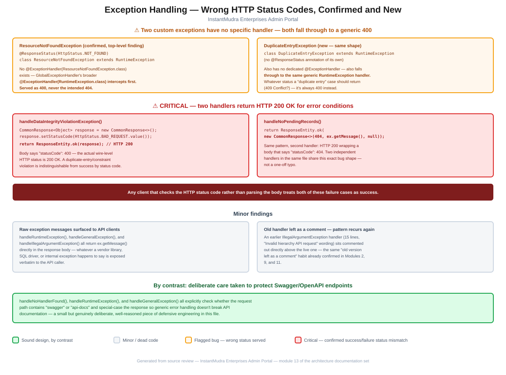

# Module 13: Exception Handling

> Part of the InstantMudra Enterprises Admin Portal architecture documentation.
> Covers `GlobalExceptionHandler` and the custom `exception/` package — confirms the top-level `ResourceNotFoundException` finding precisely, and surfaces two exception handlers that return HTTP 200 for genuine error conditions.

## Figure 1 — Wrong status codes diagram



*(Standalone version: [`13-exception-handling-flow.pdf`](13-exception-handling-flow.pdf) / [`.svg`](13-exception-handling-flow.svg))*

---

## 1. Two custom exceptions have no specific handler and fall through to a generic 400

[`GlobalExceptionHandler`](../../src/main/java/com/im/admin/controller/advice/GlobalExceptionHandler.java) (`@RestControllerAdvice`) declares 14 `@ExceptionHandler` methods, but the `exception/` package has 6 custom exception classes — and 2 of them have no matching handler:

**`ResourceNotFoundException`** — the exact class the top-level project documentation flags:

```java
@ResponseStatus(value = HttpStatus.NOT_FOUND)
public class ResourceNotFoundException extends RuntimeException {
    public ResourceNotFoundException(String message) { super(message); }
}
```

There is no `@ExceptionHandler(ResourceNotFoundException.class)` anywhere in `GlobalExceptionHandler`. Because a `@RestControllerAdvice`'s explicit `@ExceptionHandler` mappings take priority over an exception class's own `@ResponseStatus` annotation, and `ResourceNotFoundException extends RuntimeException` directly, it's caught by the broader `@ExceptionHandler(RuntimeException.class)` handler instead — which unconditionally returns `HttpStatus.BAD_REQUEST` (400). **`ResourceNotFoundException`'s `@ResponseStatus(404)` is fully confirmed dead code**, with the exact class hierarchy now traced.

**`DuplicateEntryException`** has the identical shape and hadn't been previously documented:

```java
public class DuplicateEntryException extends RuntimeException {
    public DuplicateEntryException(String message) { super(message); }
}
```

No `@ResponseStatus` annotation, and — like `ResourceNotFoundException` — no dedicated `@ExceptionHandler`. It also falls through to the generic `RuntimeException` handler and is always served as 400, regardless of whatever status a "duplicate entry" condition might more naturally warrant (409 Conflict, for instance).

Of the 6 custom exceptions, the other 4 — `CustomValidationException`, `UserNotFoundException`, `FileValidationException`, `NoPendingRecordsFoundException` — each have their own working `@ExceptionHandler`.

---

## 2. Critical: two handlers return HTTP 200 OK for error conditions

Two of the working handlers have a different, more consequential problem — the wire-level HTTP status doesn't match the error being reported at all:

```java
@ExceptionHandler(DataIntegrityViolationException.class)
public ResponseEntity<CommonResponse<Object>> handleDataIntegrityViolationException(DataIntegrityViolationException ex) {
    ...
    CommonResponse<Object> response = new CommonResponse<>();
    response.setStatusCode(HttpStatus.BAD_REQUEST.value());
    response.setMessage(message);
    response.setData(null);
    return ResponseEntity.ok(response);   // ← HTTP 200
}
```

```java
@ExceptionHandler(NoPendingRecordsFoundException.class)
public ResponseEntity<CommonResponse<String>> handleNoPendingRecords(NoPendingRecordsFoundException ex) {
    return ResponseEntity.ok(new CommonResponse<>(404, ex.getMessage(), null));   // ← HTTP 200
}
```

Both methods build a `CommonResponse` whose embedded `statusCode` field correctly says `400` or `404` — but both then wrap it in `ResponseEntity.ok(...)`, which sends **HTTP 200** on the wire regardless of what the body claims. **Any client that checks the actual HTTP status code — rather than parsing the JSON body for a nested `statusCode` field — will treat a duplicate-entry constraint violation, or a "no pending records" condition, as a successful response.** This is not an isolated typo: it's the same bug shape in two independent handlers within the same file, suggesting a habit of using `ResponseEntity.ok()` as a default "return something" reflex rather than deliberately choosing the status per case (contrast with `handleUserNotFound()`, `handleAccessDeniedException()`, `handleIllegalStateException()`, and others in the same file, which all correctly set a non-200 `ResponseEntity.status(...)`).

---

## 3. Minor findings

- **Raw exception messages are surfaced directly to API clients** in several handlers — `handleRuntimeException()`, `handleGeneralException()` (`"Something Went Wrong - " + ex.getMessage()`), and `handleIllegalArgumentException()` all return `ex.getMessage()` verbatim in the response body. Whatever a vendor library, JDBC driver, or internal exception happens to say — potentially including SQL fragments, internal class names, or other implementation detail — is exposed to whoever called the API. A mild information-disclosure habit, consistent with the broader "unfiltered data exposure" theme already documented in [Module 11](11-notifications.md) and [Module 12](12-logging-audit.md).
- **The "old handler left as a comment" pattern recurs again**: a 15-line, earlier version of the `IllegalArgumentException` handler (with "Invalid hierarchy API request" wording) sits fully commented out directly above the live one. This is at least the fourth confirmed instance of this exact habit across the review, after [Module 2](02-hierarchy-access-model.md#41-hierarchyaccessservice)'s `HierarchyAccessService`, [Module 9](09-fund-movement.md#3-fundrequestserviceimpls-approval-path-is-entirely-dead-prefundrequestserviceimpl-is-the-flow-actually-used)'s `PrefundRequestServiceImpl`, and [Module 11](11-notifications.md#4-minor-findings)'s `WebSocketService`.

---

## 4. By contrast: deliberate care taken to protect Swagger/OpenAPI endpoints

Worth noting explicitly: `handleNoHandlerFound()`, `handleRuntimeException()`, and `handleGeneralException()` all check whether the current request path contains `"swagger"` or `"api-docs"` and special-case their response so that generic error-handling logic doesn't interfere with API documentation being served correctly. This is a small but genuinely deliberate piece of defensive engineering, unrelated to (and not undermined by) the status-code issues documented above.

---

## 5. Summary of risks specific to this module

1. **Two exception handlers return HTTP 200 for genuine error conditions** (`handleDataIntegrityViolationException()`, `handleNoPendingRecords()`) — a client relying on standard HTTP status semantics will misread these failures as successes. This is the most severe, and entirely new, finding in this module (§2).
2. **`ResourceNotFoundException`'s `@ResponseStatus(404)` is confirmed dead**, served as 400 via the generic `RuntimeException` handler — matching the top-level finding exactly, now traced through the precise class hierarchy (§1).
3. **`DuplicateEntryException` has the identical, previously-undocumented problem** — no dedicated handler, always served as 400 (§1).
4. **Minor**: raw exception messages leak into API responses in several handlers, and the codebase's recurring "old code left as a comment" habit shows up here too (§3).

These confirm the "`ResourceNotFoundException`'s `@ResponseStatus(404)` is dead" bullet in the top-level [`CLAUDE.md`](../../CLAUDE.md) precisely, extend it to a second, previously-uncatalogued exception with the same shape, and surface a new, higher-severity finding — HTTP 200 responses for genuine failures — not documented there at all.

---

*Next module (pending your go-ahead): Deployment — the last of the originally identified candidates.*
