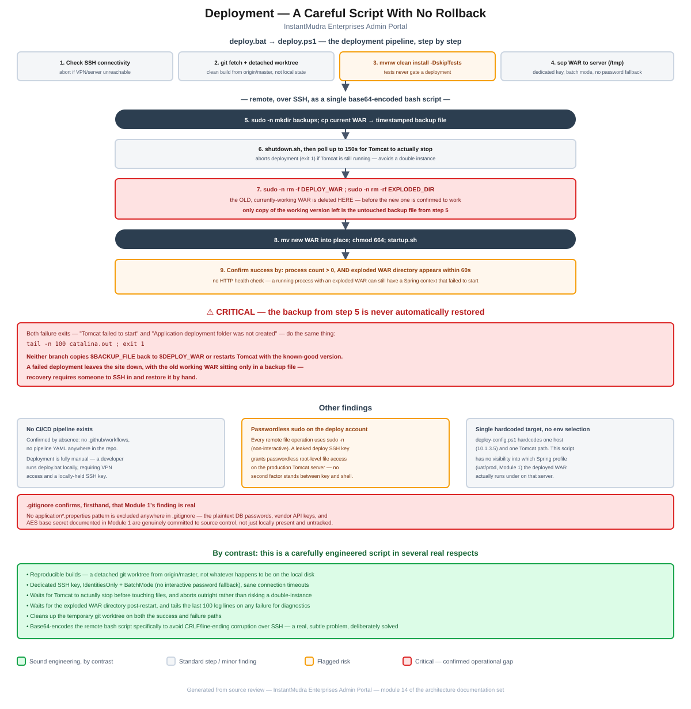

# Module 14: Deployment

> Part of the Smart Credit Solution Enterprises Admin Portal architecture documentation.
> Covers `deploy.bat`/`deploy.ps1`/`deploy-config.ps1` — a genuinely careful, working deployment script with one significant operational gap: it takes a backup on every run and never automatically restores it.

## Figure 1 — Deployment pipeline & rollback gap diagram



*(Standalone version: [`14-deployment-flow.pdf`](14-deployment-flow.pdf) / [`.svg`](14-deployment-flow.svg))*

---

## 1. The pipeline

[`deploy.bat`](../../deploy.bat) invokes [`deploy.ps1`](../../deploy.ps1) (configured by [`deploy-config.ps1`](../../deploy-config.ps1)), which runs a sequential, developer-triggered pipeline:

1. **Connectivity check** — a trial SSH command; aborts immediately with a clear message ("Connect the VPN and try again") if the server isn't reachable.
2. **`git fetch origin master`**, then a **detached `git worktree`** is created from `origin/master` into a throwaway directory — the build is reproducible from the actual remote branch state, not whatever happens to be sitting in the developer's local working directory.
3. **`mvnw.cmd clean install -DskipTests`** builds the WAR in that clean worktree.
4. **`scp`** uploads the WAR to `/tmp` on the target server, using a dedicated SSH key with `IdentitiesOnly=yes` and `BatchMode=yes` (no interactive password fallback if the key doesn't work — it fails loudly instead).
5. The remainder runs **remotely**, as a single bash script SSH'd to the server. To avoid Windows/PowerShell mangling line endings in transit, the script is normalized to LF, UTF-8-encoded, base64-encoded, and reconstructed on the remote end via `base64 --decode | bash` — a deliberate, specific fix for a real cross-platform problem.
6. **Backup**: `sudo -n cp` the currently-deployed WAR to a timestamped file in a backup directory.
7. **Stop Tomcat**: runs `shutdown.sh`, then polls `pgrep` for up to 150 seconds (30 × 5s) waiting for the process to actually exit — and **aborts the deployment outright** if it's still running afterward, rather than risking two Tomcat instances on the same port.
8. **Remove the old deployment**: `sudo -n rm -f` the deployed WAR and `sudo -n rm -rf` the exploded application directory.
9. **Deploy the new WAR**: move it into place, `chmod 664`, `startup.sh`.
10. **Confirm success**: poll for the Tomcat process count (warns if more than one is running, fails if zero), then poll for up to 60 seconds for the exploded WAR directory to reappear on disk. On any failure, `tail -n 100 catalina.out` is printed for immediate diagnostics.
11. **Cleanup**: the temporary git worktree is removed on both the success and failure paths (the `catch` block in `deploy.ps1` calls the same cleanup function).

This is materially more careful than a typical ad-hoc deploy script — the connectivity pre-check, the wait-for-stop/wait-for-start polling, the CRLF fix, and the symmetric cleanup on failure are all signs of iteration against real problems, not a first draft.

---

## 2. Critical: the backup taken in step 6 is never automatically restored

Both of the script's failure exits — "Tomcat failed to start" and "Application deployment folder was not created" — do the identical thing:

```bash
echo "Application deployment folder was not created."
tail -n 100 "$TOMCAT_HOME/logs/catalina.out"
exit 1
```

Neither one — nor anything else in the remote script — ever copies `$BACKUP_FILE` back to `$DEPLOY_WAR` or attempts to restart Tomcat with the known-good previous version. Tracing the sequence: the backup is taken in step 6, but the **old, working WAR and its exploded directory are deleted in step 8, before the new WAR has been confirmed to work at all**. If the new WAR then fails to start (steps 9–10), the script simply exits — leaving Tomcat down, with the only surviving copy of the previously-working application sitting untouched in a timestamped backup file. **Recovery requires a human to SSH into the server and manually copy the backup back into place** — there is no automated rollback path despite the backup existing specifically to enable one.

---

## 3. Other findings

- **No application-level health check.** Success is determined by process count and the exploded-directory's existence on disk — neither confirms the Spring Boot context inside actually finished initializing or is serving real HTTP traffic. A WAR can explode successfully with Tomcat running while the application itself is non-functional (a database connectivity failure, a bean-wiring error), and this script would still report "Deployment completed successfully."
- **`-DskipTests` unconditionally skips the test suite** at build time. Combined with [Module 1](01-core-bootstrap-config.md#2-build-definition-pomxml)'s finding that there's effectively no real test suite in this codebase to begin with, this is somewhat moot today — but it means even if tests were added later, this pipeline wouldn't run them as a deployment gate without a separate change.
- **No CI/CD pipeline exists at all** — confirmed by direct absence: no `.github/workflows` directory, no other pipeline configuration anywhere in the repository. Deployment is a fully manual process: a developer runs `deploy.bat` on their own machine, which requires VPN access and a locally-held SSH private key (`~/.ssh/ScsGateway_deploy`).
- **Passwordless (`sudo -n`) privilege on the deploy account for every remote file operation** — backup, delete, move, and `chmod` all run via non-interactive `sudo`. This is a standard shape for deploy automation, but it means the deploy SSH key alone — with no second factor — is sufficient for root-level file operations against the production Tomcat installation. If that key were ever exposed, this is the blast radius.
- **A single hardcoded target** — `deploy-config.ps1` points at exactly one host (`10.1.3.5`) and one `TomcatHome` path, with no environment parameter. This script has no visibility into which Spring profile (`uat` vs. `prod`, per [Module 1](01-core-bootstrap-config.md#3-configuration-profiles)) the deployed WAR actually runs under once it lands on that server — that selection happens entirely outside what this repository shows.
- **`.gitignore` directly confirms, firsthand, that [Module 1](01-core-bootstrap-config.md#31-applicationproperties-base--applies-to-every-profile)'s credential-exposure finding is real, not just locally present**: no `application*.properties` pattern (or any secrets-shaped pattern) is excluded anywhere in it. The plaintext DB passwords, vendor API keys, and AES base secret documented there are genuinely committed to source control, confirmed by reading the exclusion rules rather than inferring it.

---

## 4. Summary of risks specific to this module

1. **No automatic rollback on deployment failure** — the script takes a timestamped backup on every run but never restores it, leaving a failed deployment down until someone manually intervenes over SSH. This is the most severe and entirely new finding in this module (§2).
2. **No application-level health check** — deployment "success" is judged by process count and directory existence, not by confirming the application actually serves traffic (§3).
3. **No CI/CD automation** — deployment depends on a single developer's local machine, VPN access, and SSH key, with no pipeline enforcing tests, code review gates, or consistent process (§3).
4. **Passwordless sudo on the deploy account** compounds the blast radius of a leaked SSH key, and the credentials that key would help expose are, per `.gitignore`, genuinely committed to the repository already (§3).

This is the final module of the originally identified candidate list. Taken together with the rest of this documentation set, the deployment pipeline is one of the more carefully engineered pieces of this codebase — the rollback gap is a real, fixable operational risk, not a sign of carelessness on the level of some of the application-code findings in earlier modules.

---

*This concludes the planned module list (Core/Bootstrap through Deployment). Further modules would need to be scoped fresh — remaining unexplored areas include Products/Schemes configuration, Reporting/Export internals, and the raw controller/service layers for domains not yet covered in depth (AEPS/DMT/Recharge transaction flows beyond what Module 5 sampled).*
